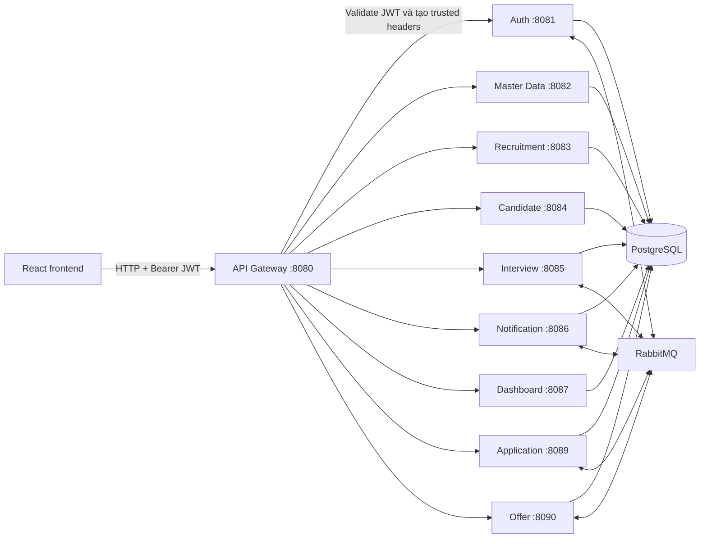

# ATS - Applicant Tracking System

Hệ thống quản lý tuyển dụng dành cho **một doanh nghiệp duy nhất**, xây dựng theo
kiến trúc microservices với Spring Boot 3 và React 19/TypeScript.

> Phạm vi chính thức: single-company, không có tenant và không có
> `PLATFORM_ADMIN`. Backend phân quyền theo role, phòng ban, người được giao và
> quyền sở hữu hồ sơ ứng viên.

## 1. Phạm Vi Hệ Thống

- Một hồ sơ doanh nghiệp dùng chung cho toàn hệ thống.
- Bốn role: `COMPANY_ADMIN`, `RECRUITER`, `HIRING_MANAGER`, `CANDIDATE`.
- Nhân viên nội bộ không tự đăng ký; `COMPANY_ADMIN` tạo tài khoản và gán phòng ban.
- Ứng viên tự đăng ký, xác thực email, đăng nhập, cập nhật hồ sơ/CV, ứng tuyển và
  theo dõi application, interview, offer của chính mình.
- `COMPANY_ADMIN` có phạm vi toàn doanh nghiệp.
- `RECRUITER` và `HIRING_MANAGER` bị giới hạn theo phòng ban và assignment được
  backend kiểm tra.
- Không có permission table hay permission động; policy hiện tại là RBAC kết hợp
  department, assignment và candidate self-ownership trong source code.

## 2. Role Và Trách Nhiệm

| Role | Phạm vi | Trách nhiệm chính |
| --- | --- | --- |
| `COMPANY_ADMIN` | Toàn doanh nghiệp | User, company profile, master data, audit và toàn bộ nghiệp vụ tuyển dụng |
| `RECRUITER` | Phòng ban hoặc resource được giao | Duyệt requisition, quản lý posting, candidate, application, interview và offer |
| `HIRING_MANAGER` | Phòng ban của tài khoản | Tạo/theo dõi requisition, tham gia phỏng vấn và nghiệp vụ thuộc phòng ban |
| `CANDIDATE` | Dữ liệu của chính tài khoản | Hồ sơ/CV, application, interview và offer cá nhân |

`departmentId` bắt buộc về mặt nghiệp vụ với `RECRUITER` và `HIRING_MANAGER`.
`COMPANY_ADMIN` và `CANDIDATE` không mang department scope.

## 3. Authentication Và Authorization

Tất cả người dùng đăng nhập bằng `email + password` tại `POST /api/auth/login`.
Mật khẩu được hash bằng BCrypt. Tài khoản chỉ đăng nhập được khi có status
`ACTIVE`; các status còn lại là `PENDING_VERIFICATION`, `LOCKED`, `INACTIVE`.

Auth service cấp:

- Access token JWT, mặc định 15 phút.
- Refresh token opaque, mặc định 7 ngày, chỉ lưu SHA-256 digest trong database.
- JWT claims: `sub` (user ID), `email`, `role`, `departmentId` nếu có, `iat`, `exp`.
- Không có `tenantId` hoặc company claim.

Gateway validate JWT, xóa identity header do client gửi và tạo lại:
`X-User-Id`, `X-User-Email`, `X-User-Role`, `X-Department-Id`. Domain services tạo
`SecurityContext` từ các header nội bộ và tiếp tục enforce policy ở controller,
service và repository/specification. Frontend route/menu chỉ hỗ trợ UX, không thay
thế authorization ở backend.

## 4. Kiến Trúc Hiện Tại



Mô tả đầy đủ hơn: [ATS_CURRENT_ARCHITECTURE.md](ATS_CURRENT_ARCHITECTURE.md).

## 5. Microservices

| Thành phần | Port local | Database | Chức năng |
| --- | ---: | --- | --- |
| API Gateway | 8080 | - | Routing, CORS, JWT validation, identity propagation |
| Auth Service | 8081 | `ats_auth` | Login, registration, token lifecycle, account/company profile |
| Master Data Service | 8082 | `ats_masterdata` | Department và danh mục tuyển dụng |
| Recruitment Service | 8083 | `ats_recruitment` | Requisition và job posting |
| Candidate Service | 8084 | `ats_candidate` | Candidate profile, CV, talent pool |
| Interview Service | 8085 | `ats_interview` | Lịch, slot, evaluation, salary proposal |
| Notification Service | 8086 | `ats_notification` | Notification và audit log |
| Dashboard Service | 8087 | `ats_dashboard` | Dashboard tổng hợp |
| Application Service | 8089 | `ats_application` | Application pipeline, comment, history |
| Offer Service | 8090 | `ats_offer` | Offer lifecycle và candidate response |
| Frontend | 5173 | - | Internal workspace và candidate portal |

## 6. Công Nghệ

- Java 21, Spring Boot 3, Spring Security, Spring Data JPA, Flyway.
- Spring Cloud Gateway và JJWT.
- PostgreSQL 16, RabbitMQ, Redis.
- React 19, TypeScript, Vite, Redux Toolkit, Ant Design.
- Docker Compose cho môi trường local/demo.

## 7. Khởi Chạy

Cả hệ thống chạy bằng Docker, **giống nhau ở máy local và trên VPS**. Yêu cầu: Docker (Docker Desktop trên
Windows/macOS) và Git Bash hoặc shell bash; máy nên có từ 8 GB RAM.

```bash
git clone https://github.com/thanhduongw/ATS.git && cd ATS
cp .env.example .env              # điền mật khẩu Postgres/RabbitMQ, JWT_SECRET, PUBLIC_URL (xem chú thích trong file)
# tạo 4 file bí mật của service: auth-service/.env, candidate-service/.env,
# notification-service/.env, ai-service/.env (mail, S3, khóa AI) — xem deploy/README.md
bash deploy/build.sh              # build lần lượt từng image rồi khởi động; lần đầu 20–30 phút
```

- Mở `PUBLIC_URL` (local: http://localhost). Chỉ Caddy mở cổng 80/443; các service, DB, RabbitMQ không mở cổng ra ngoài.
- Sửa code một service rồi chạy lại: `bash deploy/build.sh <service>` (ví dụ `bash deploy/build.sh frontend`).
- Xem trạng thái / log: `docker compose ps`, `docker compose logs -f auth-service`.
- Tắt / bật: `docker compose stop` / `bash deploy/start.sh`.
- Mobile (Expo) chạy ngoài Docker: `cd mobile && npx expo start`, đặt `EXPO_PUBLIC_API_BASE_URL=<PUBLIC_URL>/api`
  trong `mobile/.env`.

Chi tiết cài VPS, sao lưu và xử lý lỗi: [deploy/README.md](deploy/README.md).

## 8. Dữ Liệu Ban Đầu

DB mới chỉ có công ty và một quản trị viên do `docker/postgres-init` tạo khi volume Postgres còn trống:
`le.quan@example.com` / `Password123!` — **đổi mật khẩu ngay sau lần đăng nhập đầu** (mật khẩu này công khai
trong repo). Danh mục nạp sẵn chỉ gồm những gì hệ thống cần hoặc mọi công ty dùng như nhau: mẫu email, quy trình 6 giai đoạn,
nguồn "Trang tuyển dụng của công ty", lý do từ chối chung, loại hình làm việc, loại hợp đồng, trình độ học vấn, mức
kinh nghiệm. Phòng ban, chức danh, cấp bậc, kỹ năng, địa điểm làm việc, tiêu chí phỏng vấn do Quản trị tự tạo.
Mọi dữ liệu khác nhập trên giao diện như người dùng thật.

Luồng sử dụng đề xuất:

1. `COMPANY_ADMIN` cấu hình phòng ban và mời tài khoản nội bộ.
2. `HIRING_MANAGER` tạo và submit requisition trong phòng ban.
3. `RECRUITER` duyệt requisition và publish job posting.
4. Candidate xem `/careers`, tự đăng ký, xác thực email và cập nhật CV.
5. Candidate ứng tuyển; recruiter xử lý pipeline, interview và offer.
6. Candidate theo dõi và phản hồi offer trong portal của chính mình.

## 9. API Documentation

- Mọi API đi qua gateway tại `<PUBLIC_URL>/api/...`.
- Repo không có Postman collection.

## 10. Kiểm Thử

Mỗi backend module có Maven wrapper và test độc lập:

```powershell
cd auth-service
.\mvnw.cmd clean test
```

Frontend và mobile:

```bash
cd frontend && npx tsc -b --noEmit && npm run lint
cd mobile && npm run typecheck && npm run lint
```

## 11. Giới Hạn Đã Biết

- Không hỗ trợ nhiều doanh nghiệp, tenant switching hay `PLATFORM_ADMIN`.
- Không có permission động/permission management UI.
- Service-to-service cryptographic identity chưa được triển khai; Docker network là
  trust boundary vận hành hiện tại.
- Chưa có browser E2E, Docker E2E hoặc Testcontainers migration suite.
- Access/refresh token frontend đang lưu trong `localStorage`; production nên đánh
  giá lại cookie `HttpOnly` và CSRF strategy.
- Các migration xóa cột tenant có guard để từ chối dữ liệu legacy nhiều tenant; cần
  backup và reconcile trước khi chạy trên database cũ.
- Account internal legacy thiếu `departmentId` chưa được backfill. List
  specification đã fail-closed với trường hợp này (user không thấy gì thay vì thấy
  toàn bộ), nhưng dữ liệu vẫn cần backfill để họ làm việc được.
- Đồng bộ stage sau khi candidate accept/decline offer chạy bất đồng bộ qua
  RabbitMQ. Nếu broker chết, offer vẫn được ghi nhận nhưng application chưa chuyển
  stage; chưa có outbox/retry nên cần đối soát thủ công.
- Automation còn lại dùng role `SYSTEM` (auto-advance sau đánh giá phỏng vấn tích
  cực, notification tra cứu interview) vẫn bị downstream từ chối; đây là
  best-effort và được nuốt lỗi, không chặn nghiệp vụ chính.
- Google OAuth2 chưa được route đầy đủ qua gateway/Docker; email/password là flow
  authentication chính thức cho demo hiện tại.
- Admin status update chưa chặn việc activate candidate chưa verify email.

## 12. Tài Liệu

Tài liệu dự án (kiến trúc, API reference, tài khoản demo, thiết kế giao diện, báo cáo) lưu ngoài repo.
API xem trực tiếp qua Swagger/OpenAPI của từng service (mục trên).
