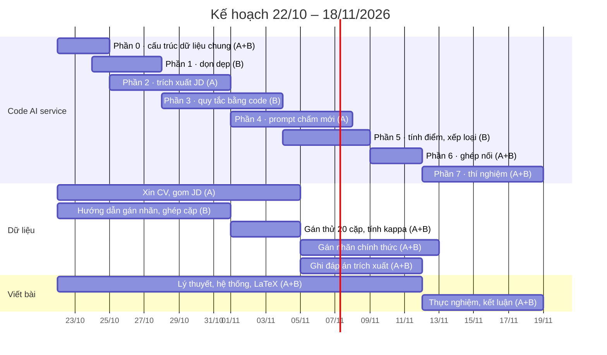

# Kế hoạch triển khai chấm điểm CV

> Ngày lập: 22/10/2026

## 1. Tóm tắt

Trong 4 tuần (22/10 đến 18/11/2026), nhóm sửa AI service theo 6 bước của tài liệu "Đề xuất cách chấm điểm CV theo cơ sở", tự xây dữ liệu có đáp án, rồi chạy thí nghiệm so sánh phương pháp để đưa vào báo cáo khóa luận và bài báo.

**Các quyết định đã chốt:**

| Hạng mục | Quyết định |
| --- | --- |
| Hướng AI | Gemini qua prompt + rubric + benchmark |
| Phạm vi tính năng | Tập trung vào chấm điểm CV; gỡ chức năng sinh JD khỏi AI service, JD do HR hoặc phòng ban viết |
| Phạm vi code đợt này | AI service (Python) |
| Cách chấm | Làm đủ 6 bước: trích xuất JD, 5 tiêu chí O\*NET, mốc riêng cho từng tiêu chí, kiểm tra yêu cầu bắt buộc, trọng số bằng nhau, 3 trạng thái Phù hợp / Không phù hợp / Chưa phân loại |
| Trích xuất JD | Tự động; độ chính xác được đo bằng đáp án do nhóm ghi |
| Thông tin cá nhân | Bỏ đọc giới tính và ngày sinh khỏi CV |
| Dữ liệu đánh giá | 30–50 CV thật ngành IT (tiếng Việt và tiếng Anh), xin có đồng ý và ẩn danh; JD lấy từ tin tuyển dụng công khai; hai bạn chấm độc lập theo rubric để làm đáp án |
| Thí nghiệm cho bài báo | So sánh phương pháp. Độ chính xác trích xuất CV và JD đưa vào báo cáo khóa luận |
| Cách làm code | Mỗi phần có một prompt (file `PROMPTS_CLAUDE_CLI.md`); nhóm đưa prompt cho Claude CLI thực hiện, đọc toàn bộ code, push lên nhánh `feat/cham-diem-v2`; Claude (claude.ai) review code mới nhất trên GitHub trước khi sang đợt sau |
| Chia việc | Bạn A: phần dùng AI (prompt, trích xuất JD, chấm bằng LLM). Bạn B: phần code thuần (quy tắc, tính điểm, xếp loại) và dữ liệu |

## 2. Luồng chấm mới so với hiện tại

Khung hệ thống giữ nguyên (worker nghe hồ sơ mới, lưu `ai_scores`, phát sự kiện cho Java). Thay đổi nằm ở **phần giữa**: cách đọc JD, cách chấm từng tiêu chí và cách xếp loại.

| Bước | Hiện tại | Sau khi sửa |
| --- | --- | --- |
| Đọc CV | Gemini trích xuất CV, lưu `cv_extractions`; có đọc giới tính, ngày sinh | Giữ nguyên cách làm; **bỏ giới tính và ngày sinh**; tăng phiên bản prompt |
| 1. Trích xuất JD | Chưa có; mỗi lần chấm Gemini đọc lại toàn bộ JD | **Mới:** Gemini tách JD thành danh sách yêu cầu (bắt buộc / ưu tiên), lưu bảng mới `jd_extractions`; cùng một nội dung JD chỉ trích xuất một lần, mọi CV dùng chung |
| 2. Tiêu chí | 5 tiêu chí | Giữ 5 tiêu chí, ghi rõ ánh xạ O\*NET |
| 3. Chấm mức 0–4 | Gemini chấm cả 5 tiêu chí với mô tả mức chung | **Code** chấm Số năm (11 khoảng O\*NET) và bậc học (Khung trình độ quốc gia); **Gemini** chấm Kỹ năng, Kinh nghiệm liên quan, Lĩnh vực và độ phù hợp ngành học, theo mô tả mức riêng, kèm dẫn chứng trích từ CV |
| 4. Yêu cầu bắt buộc | Gemini liệt kê yêu cầu chưa đạt; chỉ cảnh báo | Mỗi yêu cầu bắt buộc có trạng thái **Đạt / Không đạt / Không xác định được**; số năm và bậc học do code kiểm tra; dùng để xếp loại |
| 5. Điểm tổng | Trọng số 35/25/15/10/15 | **Trọng số bằng nhau** (Dawes, 1979) |
| 6. Xếp loại | Phù hợp tốt / Tiềm năng / Chưa phù hợp (ngưỡng 65 / 45) | **Phù hợp / Không phù hợp / Chưa phân loại** (ngưỡng T = 62,5, vùng không chắc chắn ± 5) |
| Sinh JD | Có API sinh JD và sinh "benchmark criteria" | **Gỡ bỏ** |

**Kết quả chấm sau khi sửa** (lưu trong `ai_scores.result`): điểm 0–100; trạng thái; lý do xếp loại; mức, dẫn chứng và điểm của từng tiêu chí; danh sách yêu cầu bắt buộc với trạng thái; nhận xét tiếng Việt.

## 3. Việc cần làm theo từng bước

Code chia thành 8 phần, làm theo 5 đợt (xem `PROMPTS_CLAUDE_CLI.md`): đợt 1 phần 0; đợt 2 phần 1, 2, 3; đợt 3 phần 4, 5; đợt 4 phần 6; đợt 5 phần 7. Các phần trong cùng đợt sửa file khác nhau nên làm song song được. Tất cả file nằm trong thư mục `ai-service/`.

| Phần | Việc | File chính | Người | Kiểm tra xong khi |
| --- | --- | --- | --- | --- |
| 0. Cấu trúc dữ liệu chung | Định nghĩa danh sách yêu cầu JD (`ExtractedJD`), đầu ra mới của Gemini khi chấm, kết quả chấm mới, 3 trạng thái xếp loại | A: `app/schemas/jd_extraction.py`, `app/schemas/scoring_llm.py` (mới). B: `app/schemas/scoring.py` | A + B cùng đọc | Cả hai giải thích được từng trường dùng để làm gì |
| 1. Dọn dẹp | Gỡ sinh JD (API, engine, prompt, schema, router); bỏ đọc giới tính và ngày sinh trong trích xuất CV, tăng phiên bản prompt lên v1.3 | `app/api/jd_generation.py`, `app/services/jd_generation_engine.py`, `app/services/prompts/jd_generation.py`, `app/schemas/jd_generation.py`, `app/main.py`, `app/schemas/cv_extraction.py`, `app/services/prompts/cv_extraction.py` | B | Các test trích xuất CV và test nền tảng chạy qua; trang API docs không còn endpoint sinh JD. Test chấm điểm cũ tạm thời lỗi từ sau phần 0, được sửa ở phần 6–7 |
| 2. Trích xuất JD (Bước 1) | Prompt tách JD thành yêu cầu; lưu bảng `jd_extractions` theo mã băm nội dung JD + phiên bản prompt; có rồi thì dùng lại | `app/services/prompts/jd_extraction.py`, `app/services/jd_extraction_store.py` (mới), `app/models/__init__.py`, `docker/postgres-init/init-databases.sql` | A | Test với LLM giả qua; chạy thật 3 JD, kết quả đúng khi đọc bằng mắt |
| 3. Quy tắc bằng code (Bước 3, phần code) | Đổi số năm ra 11 khoảng O\*NET và mức 0–4; đổi tên bằng (Cử nhân, Kỹ sư, Bachelor, Thạc sĩ…) ra bậc Khung trình độ quốc gia; kiểm tra yêu cầu bắt buộc về số năm và bậc học; lập danh sách yêu cầu cần Gemini kiểm tra (`items_to_check`) | `app/services/scoring/rules.py` (mới) | B | Test đủ các trường hợp biên (đúng ngưỡng khoảng, thiếu ngày, bằng nước ngoài, không nhận ra bằng) |
| 4. Prompt chấm mới (Bước 3 phần AI + Bước 4) | Gemini nhận danh sách yêu cầu JD + hồ sơ đã lọc; chấm Kỹ năng, Kinh nghiệm liên quan, Lĩnh vực, độ phù hợp ngành học theo mô tả mức riêng; trả trạng thái từng yêu cầu cần kiểm tra kèm dẫn chứng; phiên bản prompt v2.0 | `app/services/scoring/prompt.py` | A | Test ghép prompt qua; chạy thật 2 cặp, dẫn chứng trích đúng từ CV |
| 5. Tính điểm và xếp loại (Bước 4, 5, 6) | Gộp mức từ code và Gemini; danh sách yêu cầu bắt buộc; trọng số bằng nhau; quy tắc 3 trạng thái với T và δ; lý do xếp loại; cấu hình T = 62,5, δ = 5 thay cho ngưỡng 65 / 45 | `app/services/scoring/aggregate.py` (mới), `app/core/config.py`, `.env.example`, hàm `scoring_options()` trong `app/services/application_scoring.py` | B | Test: ranh giới 57,4 / 57,5 / 67,4 / 67,5; thiếu bắt buộc thành Không phù hợp; không xác định được thành Chưa phân loại |
| 6. Ghép nối | Viết lại `score_candidate` dùng prompt v2 và `aggregate`; luồng chấm hồ sơ thêm bước trích xuất JD; lưu kết quả mới; cập nhật test chấm điểm | `app/services/scoring/engine.py`, `app/services/application_scoring.py`, `app/api/application_scores.py` (nếu cần), `tests/test_phase2_scoring.py` | A + B | Toàn bộ test qua (trừ benchmark); nộp một hồ sơ thật, kết quả trong DB đúng cấu trúc mới. Merge nhánh vào `main` |
| 7. Thí nghiệm | Nạp dữ liệu nhóm tự gán nhãn; thêm phương pháp so sánh; thêm script đo độ chính xác trích xuất | `benchmark/` (sửa `prepare_data.py`, `baselines.py`, `evaluate.py`; thêm `eval_extraction.py`) | A + B | 7a: công cụ chạy được với dữ liệu giả. 7b: ra bảng kết quả trên dữ liệu thật (mục 5) |

**Vì sao trích xuất JD được lưu theo nội dung JD:** khi chấm hồ sơ đầu tiên của một tin, AI service trích xuất JD rồi lưu lại; các hồ sơ sau dùng lại kết quả đó. Nếu HR sửa JD thì nội dung đổi, mã băm đổi, hệ thống tự trích xuất lại. Đây cũng là cách trích xuất CV đang làm.

## 4. Chuẩn bị dữ liệu

Dữ liệu làm song song với code ngay từ tuần 1, vì thu CV và gán nhãn tốn thời gian nhất. Mục tiêu là khoảng 200 cặp CV–JD có đáp án và 20–30 CV có đáp án trích xuất.

### 4.1. Thu CV thật (mục tiêu 30–50 CV ngành IT)

- Xin qua bạn bè, lớp, nhóm Facebook tuyển dụng IT, giống cách bài báo Gemini đã làm.
- Gửi kèm **phiếu đồng ý** ngắn: mục đích nghiên cứu, không chia sẻ ra ngoài, xóa thông tin cá nhân, xóa dữ liệu khi xong đề tài (theo Luật Bảo vệ dữ liệu cá nhân 91/2025/QH15).
- Cố gắng đa dạng: sinh viên và người đi làm; nhiều vị trí (backend, frontend, tester, data, BA…); cả CV tiếng Việt và tiếng Anh; cả PDF và Word.
- **Ẩn danh trước khi lưu:** xóa tên, số điện thoại, email, ảnh, địa chỉ, link cá nhân. Đặt tên file theo mã (CV01, CV02…).
- Chỉ đưa CV đã ẩn danh vào Gemini, vì điều khoản bản miễn phí cho phép dùng dữ liệu để cải thiện sản phẩm.

### 4.2. Gom JD (mục tiêu 10–15 JD)

- Lấy tin tuyển dụng IT công khai (TopCV, ITviec, VietnamWorks), ghi lại nguồn và ngày lấy.
- Chọn đủ cấp bậc (thực tập, junior, senior) và đủ vị trí tương ứng với CV thu được; có cả JD tiếng Việt và tiếng Anh.

### 4.3. Ghép cặp (mục tiêu khoảng 200 cặp)

- Mỗi CV ghép với 4–5 JD, chọn sao cho có cả cặp rõ hợp, rõ không hợp và cặp lưng chừng (ví dụ CV backend với JD backend senior, JD frontend, JD tester).
- Ghi cặp vào một bảng tính: mã cặp, mã CV, mã JD.

### 4.4. Gán nhãn chấm điểm (đáp án cho thí nghiệm)

1. Viết **hướng dẫn gán nhãn** từ rubric trong tài liệu đề xuất, kèm 1–2 ví dụ cho mỗi mức.
2. **Gán thử 20 cặp**: hai bạn chấm độc lập, không bàn với nhau, ghi mức 0–4 từng tiêu chí và trạng thái.
3. Tính **hệ số kappa** (độ đồng ý giữa hai người). Nếu thấp, họp lại, sửa hướng dẫn rồi gán thử lại.
4. **Gán chính thức** toàn bộ cặp, vẫn độc lập; tính kappa chính thức để đưa vào bài.
5. Cặp hai bạn chấm khác nhau thì cùng xem lại, thống nhất một đáp án cuối.
6. **Gán nhãn trước khi xem kết quả AI**, để không bị AI ảnh hưởng.
7. Nếu nhờ được một người đi làm (HR, lập trình viên lâu năm, giảng viên), nhờ chấm khoảng 30 cặp để đối chiếu.

### 4.5. Đáp án trích xuất (cho báo cáo khóa luận)

- Chọn 20–30 CV và 10 JD trong số đã có.
- Với CV, ghi tay: kỹ năng, từng công việc (chức danh, công ty, tháng bắt đầu, tháng kết thúc), bằng cấp, ngành, chứng chỉ.
- Với JD, ghi tay: các yêu cầu và đánh dấu bắt buộc hay ưu tiên; số năm; bậc học.
- Ghi theo mẫu bảng tính chung để script so sánh được (Claude sẽ đưa mẫu ở phần 7).

**Phân công:** bạn A lo thu CV và gom JD; bạn B lo hướng dẫn gán nhãn, bảng tính và ghép cặp. Gán nhãn và ghi đáp án trích xuất thì cả hai cùng làm, chia đôi số CV cho phần trích xuất.

## 5. Thí nghiệm

Thí nghiệm chính trả lời một câu hỏi: **cách chấm theo rubric có cơ sở có cho kết quả gần với người chấm hơn các cách đơn giản hay không**. Câu trả lời dù có hay không đều viết được thành bài.

**Chia dữ liệu:** khoảng 200 cặp chia thành 50 cặp hiệu chỉnh (chỉ dùng để chọn ngưỡng T và δ) và 150 cặp kiểm tra (chỉ dùng để báo cáo kết quả). Chia theo CV: một CV đã nằm trong phần hiệu chỉnh thì không xuất hiện ở phần kiểm tra.

**Các phương pháp đem so sánh:**

| # | Phương pháp | Mục đích so sánh |
| --- | --- | --- |
| 1 | Ngẫu nhiên | Mốc thấp nhất |
| 2 | TF-IDF + cosine (dò từ khóa) | AI có hơn cách không dùng AI không |
| 3 | Embedding đa ngôn ngữ + cosine | AI có hơn cách so nghĩa đơn giản không (học từ bài báo Gemini) |
| 4 | Gemini chấm thẳng 0–100, không rubric | Rubric có tác dụng không |
| 5 | Rubric cũ (5 tiêu chí, trọng số tự đặt, mô tả mức chung) | Các thay đổi có cơ sở có giúp ích không |
| 6 | **Hệ thống mới (6 bước)** | Phương pháp của nhóm |

Các phương pháp chỉ cho ra điểm (2, 3, 4) được đổi thành 3 trạng thái bằng cùng quy tắc ngưỡng, với ngưỡng chọn riêng trên phần hiệu chỉnh, để so sánh công bằng. Phương pháp 4, 5, 6 dùng cùng mô hình Gemini.

**Thước đo:**

| Thước đo | Ý nghĩa dễ hiểu |
| --- | --- |
| Accuracy, Macro-F1 (3 trạng thái) | Tỉ lệ xếp loại trùng đáp án; Macro-F1 công bằng khi số cặp mỗi loại lệch nhau |
| Tỉ lệ "Chưa phân loại" và độ chính xác trên phần còn lại | AI đẩy bao nhiêu hồ sơ cho HR xem tay, và khi AI dám kết luận thì đúng bao nhiêu |
| Tương quan Spearman giữa điểm AI và điểm người | AI có xếp thứ tự hồ sơ giống người không |
| Kappa giữa AI và đáp án, so với kappa giữa hai người gán nhãn | AI đồng ý với người có bằng mức hai người đồng ý với nhau không |
| Khoảng tin cậy (bootstrap) và kiểm định McNemar | Chênh lệch giữa hai phương pháp là thật hay do may rủi |

**Độ chính xác trích xuất (cho báo cáo khóa luận):**

| Đối tượng | Thước đo |
| --- | --- |
| Kỹ năng trong CV và JD | Precision, Recall, F1 sau khi chuẩn hóa tên (AI tìm đúng bao nhiêu, bỏ sót bao nhiêu) |
| Mốc thời gian làm việc | Tỉ lệ đúng đến tháng; sai số tổng số năm kinh nghiệm |
| Bậc học, ngành | Tỉ lệ đúng |
| Yêu cầu JD bắt buộc / ưu tiên | Tỉ lệ phân loại đúng |

**Kết quả cần có cuối cùng:** bảng thống kê dữ liệu; bảng so sánh 6 phương pháp; ma trận nhầm lẫn của hệ thống mới; 5–10 ví dụ AI chấm sai kèm nguyên nhân; bảng độ chính xác trích xuất.

**Chạy ở đâu:** tiếp tục dùng cách chạy trên Kaggle như benchmark hiện có (gọi đúng code của AI service). Chỉ đưa CV đã ẩn danh lên.

## 6. Lịch 4 tuần

Tuần 1–2, A và B code song song, đồng thời thu CV và viết hướng dẫn gán nhãn; tuần 3 ghép nối và gán nhãn chính thức; tuần 4 chạy thí nghiệm và viết phần kết quả. Gán nhãn chính thức phải xong trước khi chạy thí nghiệm.

| Tuần | Code | Dữ liệu | Viết bài |
| --- | --- | --- | --- |
| Tuần 1 (22–28/10) | Phần 0, 1; bắt đầu phần 2, 3 | Xin CV, gom JD; viết hướng dẫn gán nhãn | Lý thuyết, LaTeX |
| Tuần 2 (29/10–4/11) | Phần 2, 3, 4; bắt đầu phần 5 | Ghép cặp; gán thử 20 cặp, tính kappa | Lý thuyết, hệ thống |
| Tuần 3 (5–11/11) | Phần 5, 6 | Gán nhãn chính thức; ghi đáp án trích xuất | Hệ thống |
| Tuần 4 (12–18/11) | Phần 7 | Hoàn tất gán nhãn (đến 12/11) | Thực nghiệm, kết luận |

## 7. Rủi ro, điểm cần lưu ý và cách làm việc với Claude

Rủi ro lớn nhất là dữ liệu, không phải code; vì vậy thu CV và viết hướng dẫn gán nhãn phải bắt đầu ngay tuần này.

| Rủi ro | Cách xử lý |
| --- | --- |
| Xin được ít hơn 30 CV | Ghép mỗi CV với nhiều JD hơn; nếu vẫn thiếu, bổ sung CV giả lập do nhóm viết và ghi rõ trong bài |
| Hai bạn chấm lệch nhau nhiều (kappa thấp) | Sửa hướng dẫn gán nhãn sau vòng thử; vẫn báo cáo kappa thật |
| Hệ thống mới không hơn các phương pháp khác | Vẫn là một phát hiện; phân tích lỗi để giải thích, không chỉnh dữ liệu kiểm tra cho đẹp số |
| Giới hạn lượt gọi và chi phí Gemini | Chạy thí nghiệm trên Kaggle như lần trước; ước tính khoảng 700 lượt gọi (200 cặp × 3 phương pháp dùng Gemini, cộng trích xuất CV và JD) |
| Tăng phiên bản prompt trích xuất CV | Các CV đã lưu sẽ được trích xuất lại ở lần chấm sau (tốn thêm lượt gọi). Dữ liệu cũ trong DB vẫn chứa giới tính và ngày sinh, nên xóa bảng `cv_extractions` cũ |
| Trùng lịch với việc viết bài (đọc bài mẫu, LaTeX, tài liệu tham khảo) | Mỗi tuần dành một buổi cho việc viết bài; các mục Cơ sở lý thuyết và Hệ thống viết được ngay từ tài liệu đề xuất |

**Cách làm việc với Claude cho mỗi phần code:**

1. Đưa prompt của phần đó (trong `PROMPTS_CLAUDE_CLI.md`) cho Claude CLI thực hiện; prompt yêu cầu đọc `docs/DE_XUAT_CHAM_DIEM_CV.md` và file kế hoạch này trước.
2. Người phụ trách đọc toàn bộ code Claude CLI viết, chạy lại test, đọc báo cáo cuối của Claude CLI.
3. Push lên nhánh `feat/cham-diem-v2`, báo Claude (claude.ai) review code mới nhất trên GitHub; sửa theo góp ý.
4. Chỉ chuyển sang đợt sau khi review xong, test qua và người phụ trách tự trả lời được 3 câu: **phần này làm gì, vì sao làm vậy, cơ sở là gì**. Đây cũng là 3 câu hội đồng hay hỏi.

**Bắt đầu từ:** chép `DE_XUAT_CHAM_DIEM_CV.md` và file kế hoạch này vào `docs/`, tạo nhánh `feat/cham-diem-v2`, chạy prompt phần 0; cùng lúc bạn A bắt đầu xin CV và bạn B viết hướng dẫn gán nhãn.
