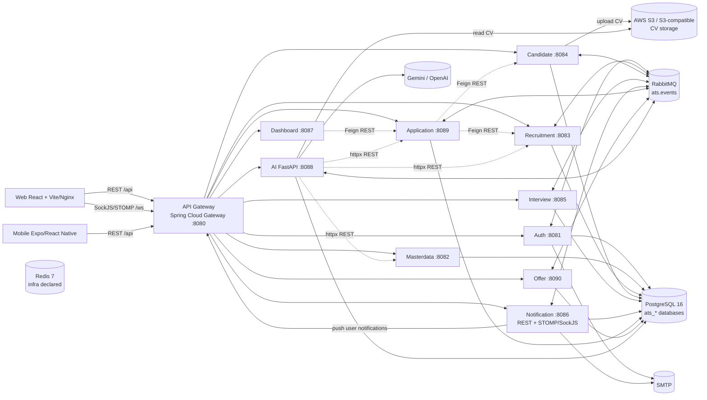

# ATS — Tổng quan repo

> Phạm vi: khảo sát tĩnh toàn repo ở mức kiến trúc và cấu hình, chưa đi vào chi tiết implementation. Tài liệu này chỉ được viết từ README, cấu trúc file, dependency manifest, runtime config và các controller/event chính. Mỗi nhận định về code đều có dẫn chứng dạng `đường/dẫn/file:line`.

## 1. Dự án giải quyết bài toán gì, cho ai?

### Làm gì

Repo này xây dựng một **Applicant Tracking System (ATS)**: hệ thống quản lý toàn bộ quy trình tuyển dụng cho **một doanh nghiệp duy nhất**. README mô tả rõ phạm vi single-company và các vai trò `COMPANY_ADMIN`, `RECRUITER`, `HIRING_MANAGER`, `CANDIDATE` (`README.md:1-21`, `README.md:23-33`).

Luồng nghiệp vụ được bao phủ từ nhu cầu tuyển dụng, đăng tin, hồ sơ ứng viên, application, interview đến offer; các nhóm API tương ứng xuất hiện trong controller của `recruitment-service`, `candidate-service`, `application-service`, `interview-service` và `offer-service` (`recruitment-service/src/main/java/iuh/fit/se/recruitment/requisition/JobRequisitionController.java:15-95`, `candidate-service/src/main/java/iuh/fit/se/candidate/candidate/CandidateController.java:20-158`, `application-service/src/main/java/iuh/fit/se/application/application/ApplicationController.java:19-180`, `interview-service/src/main/java/iuh/fit/se/interview/interview/InterviewController.java:25-152`, `offer-service/src/main/java/iuh/fit/se/offer/offer/OfferController.java:20-141`).

### Vì sao cần

Mục tiêu là gom các bước tuyển dụng đang rời rạc vào một quy trình có trạng thái, phân quyền và lịch sử: nhân sự nội bộ tạo/duyệt nhu cầu, mở vị trí, xử lý hồ sơ; ứng viên tự quản lý hồ sơ và theo dõi tiến trình của chính mình. README mô tả candidate có thể đăng ký, xác thực email, cập nhật CV, ứng tuyển và theo dõi application/interview/offer (`README.md:12-21`).

### Ai sử dụng

- `COMPANY_ADMIN`: quản trị người dùng, company profile, master data, audit và toàn hệ thống tuyển dụng (`README.md:23-30`).
- `RECRUITER`: duyệt requisition, quản lý posting, candidate, application, interview và offer trong phạm vi được phép (`README.md:25-30`).
- `HIRING_MANAGER`: tạo/theo dõi requisition và tham gia các nghiệp vụ của department (`README.md:25-30`).
- `CANDIDATE`: tự đăng ký/xác thực, cập nhật profile/CV, ứng tuyển và theo dõi dữ liệu của chính mình (`README.md:30-33`, `auth-service/src/main/java/iuh/fit/se/auth/controller/AuthController.java:62-123`, `candidate-service/src/main/java/iuh/fit/se/candidate/candidate/CandidatePortalController.java:21-50`).

### Vai trò của AI

`ai-service` hỗ trợ trích xuất text/structured data từ CV, lưu kết quả extraction, và chấm điểm độ phù hợp CV–JD. Các API chính gồm extract text, extract CV, xem/rescore một application và rescore theo posting (`ai-service/app/api/extraction.py:24-58`, `ai-service/app/api/cv_extraction.py:41-86`, `ai-service/app/api/application_scores.py:63-116`). Đây là công cụ hỗ trợ HR/recruiter, không phải nơi thay thế các domain service tuyển dụng.

## 2. Cấu trúc thư mục cấp 1–2

### Cấp 1

| Thư mục | Vai trò suy ra từ repo |
|---|---|
| `api-gateway/` | API Gateway Spring Cloud Gateway: nhận request công khai, route tới service và xử lý JWT (`api-gateway/pom.xml:18-40`, `api-gateway/src/main/resources/application.yml:1-2`, `api-gateway/src/main/resources/application.yml:33-90`). |
| `auth-service/` | Authentication, user/company profile, token lifecycle, email verification và OAuth2 client (`auth-service/src/main/java/iuh/fit/se/auth/controller/AuthController.java:49-183`, `auth-service/pom.xml:25-72`). |
| `masterdata-service/` | Danh mục dùng chung như department, skill, job title, pipeline, interview criteria và các catalog tuyển dụng; các controller nằm dưới các package domain tương ứng. Ví dụ: `masterdata-service/src/main/java/iuh/fit/se/masterdata/department/DepartmentController.java:17-52`, `masterdata-service/src/main/java/iuh/fit/se/masterdata/skill/SkillController.java:15-44`. |
| `recruitment-service/` | Job requisition và job posting (`recruitment-service/src/main/java/iuh/fit/se/recruitment/requisition/JobRequisitionController.java:15-95`, `recruitment-service/src/main/java/iuh/fit/se/recruitment/posting/JobPostingController.java:16-111`). |
| `candidate-service/` | Candidate profile, CV, talent pool/tag và S3 storage (`candidate-service/src/main/java/iuh/fit/se/candidate/candidate/CandidateController.java:20-158`, `candidate-service/src/main/java/iuh/fit/se/candidate/storage/S3Service.java:19-68`). |
| `application-service/` | Application pipeline, history, comment, assignment và stage transition (`application-service/src/main/java/iuh/fit/se/application/application/ApplicationController.java:19-180`). |
| `interview-service/` | Interview, slot/scheduling, evaluation và salary proposal (`interview-service/src/main/java/iuh/fit/se/interview/interview/InterviewController.java:25-152`, `interview-service/src/main/java/iuh/fit/se/interview/evaluation/ApplicationEvaluationController.java:19-36`). |
| `offer-service/` | Offer lifecycle, PDF, approval và candidate accept/decline (`offer-service/src/main/java/iuh/fit/se/offer/offer/OfferController.java:20-141`). |
| `notification-service/` | Notification, audit log, email và realtime WebSocket/STOMP (`notification-service/src/main/java/iuh/fit/se/notification/notification/NotificationController.java:13-41`, `notification-service/src/main/java/iuh/fit/se/notification/config/WebSocketConfig.java:9-32`). |
| `dashboard-service/` | Dashboard summary, posting statistics và PDF report (`dashboard-service/src/main/java/iuh/fit/se/dashboard/dashboard/DashboardController.java:19-35`, `dashboard-service/src/main/java/iuh/fit/se/dashboard/posting/PostingStatsController.java:14-20`). |
| `ai-service/` | Python AI microservice: API, model/schema, extraction/scoring services và RabbitMQ worker (`ai-service/app/main.py:9-18`, `ai-service/app/main.py:77-89`). |
| `frontend/` | Web SPA React/TypeScript; source chính ở `src/`, static asset ở `public/`, build bằng Vite và serve production bằng Nginx (`frontend/package.json:2-10`, `frontend/Dockerfile:1-12`). |
| `mobile/` | Mobile client Expo/React Native, có route theo role candidate/HR/HM và gọi chung API gateway; đây là client bổ sung, không phải một backend service (`mobile/package.json:1-4`, `mobile/package.json:12-37`, `mobile/.env.example:1-4`). |
| `docker/` | Infrastructure seed, hiện có PostgreSQL initialization script (`docker/postgres-init/init-databases.sql:1-12`). |
| `docs/` | Tài liệu kiến trúc, kế hoạch, API và learning; README liên kết tới các tài liệu kiến trúc/API (`README.md:169-174`, `README.md:222-229`). |
| `backups/` | Bản backup SQL theo mốc thời gian, ví dụ `backups/2026-09-03-pre-runtime-validation/ats_all_databases.sql`. Đây là artifact dữ liệu, không phải source runtime. |
| `test-samples/` | CV mẫu PDF/DOCX và file test để kiểm thử extraction/OCR; đây là dữ liệu test, không phải source runtime. |
| `tmp/` | Thư mục tạm hiện diện ở root; chưa có đủ bằng chứng từ tên file để kết luận có vai trò runtime cố định. |
| `.claude/` | Cấu hình local của công cụ phát triển; không tham gia vào runtime ATS theo các file runtime đã khảo sát. |

Ngoài các thư mục trên, root có `docker-compose.yml`, các script `start-*.bat`/`start-all.ps1`, `.env.example` và `README.md`; chúng dùng để mô tả topology, biến môi trường và cách khởi động local (`README.md:112-152`, `docker-compose.yml:1-345`).

### Cấp 2 theo loại component

**Mỗi Spring Boot service** có khuôn chung: `pom.xml` (dependency), `Dockerfile` (image), `src/main/java` (package theo domain), `src/main/resources` (application config + Flyway migration), `src/test` (test). Có thể thấy rõ ở `application-service` qua `application-service/pom.xml:1-22`, `application-service/src/main/resources/application.yml:1-37` và các package `application`, `client`, `config`, `event`, `security` trong `application-service/src/main/java/iuh/fit/se/application/`.

**`frontend/src/`** được chia theo lớp/feature: `app`, `components`, `features`, `layouts`, `routes`, `services`, `i18n`, cùng các file entry/config. Entry khởi tạo Redux Provider, i18n và BrowserRouter tại `frontend/src/main.tsx:1-19`; dependency và script build/lint nằm tại `frontend/package.json:6-47`.

**`ai-service/`** có `app/api` (HTTP endpoints), `app/core` (config/database/RabbitMQ/LLM/S3), `app/models` (ORM), `app/schemas` (Pydantic DTO), `app/services` (business logic/extraction/scoring), `app/workers` (consumer nền), `alembic` (migration), `tests`, `benchmark`, `requirements.txt` và `Dockerfile` (`ai-service/app/main.py:9-18`, `ai-service/app/main.py:29-59`, `ai-service/requirements.txt:5-46`).

## 3. Ba component chính và technology stack

### Backend Spring Boot

Có **API Gateway + 9 domain service Java**; README liệt kê service, port và nhiệm vụ từng service (`README.md:88-102`). Các module dùng Java 21 và Spring Boot parent 3.x; ví dụ `recruitment-service` khai báo Java 21, Spring Web, Spring Data JPA, Validation, AMQP, OpenFeign, PostgreSQL và Flyway (`recruitment-service/pom.xml:10-71`).

| Nhóm | Framework/thư viện chính | Bằng chứng |
|---|---|---|
| Gateway | Spring Cloud Gateway, JJWT, SpringDoc WebFlux | `api-gateway/pom.xml:18-40`, `api-gateway/pom.xml:82-83`. |
| Domain CRUD/business services | Spring Boot Web, Spring Data JPA/Hibernate, Spring Security, PostgreSQL driver, Flyway, Spring Cloud OpenFeign, Spring AMQP | `application-service/pom.xml:22-71`, `application-service/pom.xml:84-98`; cùng mẫu này xuất hiện ở các service domain khác. |
| Authentication | Spring Security, OAuth2 Client, Mail, JJWT, AMQP, JPA/Flyway | `auth-service/pom.xml:25-72`, `auth-service/pom.xml:91-103`. |
| Notification | Spring WebSocket/STOMP, Mail, AMQP, JPA/Flyway | `notification-service/pom.xml:31-75`, `notification-service/pom.xml:115-140`. |
| File/PDF/calendar chuyên biệt | AWS SDK S3 ở candidate; OpenPDF ở dashboard/offer; Biweekly ở interview | `candidate-service/pom.xml:109-118`, `dashboard-service/pom.xml:84-92`, `offer-service/pom.xml:90-104`, `interview-service/pom.xml:105-120`. |

### Frontend web

Frontend là React 19 + TypeScript + Vite. UI component chính là Ant Design; state dùng Redux Toolkit/React Redux; HTTP dùng Axios; routing dùng React Router; realtime dùng `@stomp/stompjs` + `sockjs-client` (`frontend/package.json:12-31`, `frontend/package.json:33-47`).

Entry point render React app với Redux Provider, i18n và BrowserRouter (`frontend/src/main.tsx:1-19`). Khi development, Vite chạy port 3000 và proxy `/api`, `/ws` về gateway port 8080 (`frontend/vite.config.ts:5-20`); khi Docker, app được build thành static files rồi Nginx serve (`frontend/Dockerfile:1-12`).

### AI Python service

`ai-service` là FastAPI chạy bằng Uvicorn; entrypoint tạo app, gắn router health/extraction/CV extraction/scoring và khởi động RabbitMQ worker (`ai-service/app/main.py:9-18`, `ai-service/app/main.py:62-89`).

Các nhóm thư viện chính:

- Database: SQLAlchemy async, `asyncpg`, Alembic, `pgvector` (`ai-service/requirements.txt:9-13`).
- Integration: `aio-pika` cho RabbitMQ, `httpx` để gọi Java service (`ai-service/requirements.txt:15-19`).
- LLM: OpenAI SDK và Google GenAI SDK (`ai-service/requirements.txt:21-23`); model mặc định và fallback được cấu hình ở `ai-service/app/core/config.py:35-45`.
- File/document: `boto3` cho S3, PyMuPDF, python-docx, PaddleOCR, Pillow và OpenCV (`ai-service/requirements.txt:29-42`).
- Validation/config: Pydantic và pydantic-settings (`ai-service/requirements.txt:25-27`); settings đọc từ environment hoặc `.env` (`ai-service/app/core/config.py:61-67`).

## 4. Các component giao tiếp với nhau thế nào?

### REST qua API Gateway

Browser dùng base URL `/api` mặc định và Axios tự gắn `Authorization: Bearer ...` (`frontend/src/config.ts:3-12`, `frontend/src/services/axiosClient.ts:15-18`, `frontend/src/services/axiosClient.ts:77-84`). Gateway route nguyên path tới từng downstream service: `/api/auth/**`, `/api/masterdata/**`, `/api/recruitment/**`, `/api/candidate/**`, `/api/interview/**`, `/api/notification/**`, `/api/dashboard/**`, `/api/application/**`, `/api/offer/**` và `/api/v1/ai/**` (`api-gateway/src/main/resources/application.yml:30-82`).

Trong Docker, chỉ gateway publish port 8080 cho backend client; domain service và AI chỉ `expose` trong network nội bộ (`docker-compose.yml:260-283`, `docker-compose.yml:288-323`). Frontend Docker publish host port 5173 vào Nginx port 80 (`docker-compose.yml:328-338`). Vì vậy entrypoint thường là `http://localhost:5173`, còn API public là `http://localhost:8080` khi chạy tách rời hoặc được proxy từ Nginx khi chạy Docker (`README.md:123-133`, `frontend/nginx.conf:31-55`).

### REST nội bộ giữa các Java service và AI

Java service gọi service khác bằng Spring Cloud OpenFeign, với URL lấy từ `services.*.url`. Ví dụ `application-service` gọi `recruitment-service` và `candidate-service` bằng HTTP (`application-service/src/main/java/iuh/fit/se/application/client/RecruitmentServiceClient.java:4-13`, `application-service/src/main/java/iuh/fit/se/application/client/CandidateServiceClient.java:5-16`). Dashboard cũng gọi application service để tổng hợp dữ liệu (`dashboard-service/src/main/java/iuh/fit/se/dashboard/client/ApplicationServiceClient.java:14-34`).

AI service gọi ngược Java backend bằng `httpx`; code trực tiếp đang gọi application, masterdata và recruitment service (`ai-service/app/core/config.py:55-59`, `ai-service/app/core/java_services.py:19-29`, `ai-service/app/core/java_services.py:32-88`). `CANDIDATE_SERVICE_URL` có trong settings nhưng chưa thấy usage tương ứng trong các file `ai-service/app` đã khảo sát, nên không kết luận AI đang gọi candidate-service bằng REST. Trong Docker, các biến service URL được override bằng DNS service name như `http://application-service:8089` (`docker-compose.yml:260-276`).

### Message queue RabbitMQ

RabbitMQ dùng AMQP port 5672 và management UI port 15672 (`docker-compose.yml:25-41`). Các event dùng topic exchange `ats.events`; ví dụ `application-service` publish `application.created` và khai báo queue cho `ai.scoring.completed` (`application-service/src/main/java/iuh/fit/se/application/config/RabbitMQConfig.java:16-35`).

Luồng AI bất đồng bộ chính là:

1. `application-service` phát event `application.created`.
2. AI worker consume queue `ai.application-created.queue`, chấm hồ sơ.
3. AI lưu kết quả rồi publish `ai.scoring.completed`.
4. `application-service` consume queue `application.ai-scoring-completed.queue` để nhận trạng thái/điểm (`ai-service/app/workers/scoring_worker.py:19-28`, `ai-service/app/workers/scoring_worker.py:81-89`, `ai-service/app/core/rabbitmq.py:16-27`, `application-service/src/main/java/iuh/fit/se/application/event/AiScoringListener.java:25-28`).

RabbitMQ cũng được dùng cho notification/audit và các event application, interview, offer; `notification-service` khai báo nhiều queue theo routing key (`notification-service/src/main/java/iuh/fit/se/notification/config/BusinessEventConfig.java:12-25`).

### WebSocket/STOMP cho notification realtime

`notification-service` mở SockJS endpoint `/ws`, simple broker `/queue` và user destination `/user` (`notification-service/src/main/java/iuh/fit/se/notification/config/WebSocketConfig.java:9-26`). Notification được đẩy tới `/user/{userId}/queue/notifications` (`notification-service/src/main/java/iuh/fit/se/notification/notification/RealtimePushService.java:10-17`). Frontend dùng SockJS/STOMP, gửi JWT trong STOMP `CONNECT` và subscribe `/user/queue/notifications` (`frontend/src/features/notification/websocketClient.ts:20-35`). Gateway/Nginx chuyển tiếp `/ws/**` tới notification service (`api-gateway/src/main/resources/application.yml:84-90`, `frontend/nginx.conf:49-71`).

### Port và URL quan trọng

| Thành phần | Port/URL local | Cách được nối |
|---|---:|---|
| Frontend Vite dev | `3000` | Vite proxy `/api`, `/ws` tới `http://localhost:8080` (`frontend/vite.config.ts:7-20`). |
| Frontend Docker/Nginx | host `5173` → container `80` | Docker Compose publish (`docker-compose.yml:328-338`). |
| API Gateway | `8080` | Public REST/WebSocket entrypoint (`api-gateway/src/main/resources/application.yml:1-2`). |
| Auth / Masterdata / Recruitment / Candidate | `8081` / `8082` / `8083` / `8084` | Các route gateway tương ứng (`api-gateway/src/main/resources/application.yml:34-52`). |
| Interview / Notification / Dashboard | `8085` / `8086` / `8087` | Các route gateway tương ứng (`api-gateway/src/main/resources/application.yml:54-67`). |
| AI / Application / Offer | `8088` / `8089` / `8090` | AI route và domain route (`api-gateway/src/main/resources/application.yml:69-82`); Docker expose AI ở 8088 (`docker-compose.yml:260-267`). |
| PostgreSQL / RabbitMQ / RabbitMQ UI / Redis | `5432` / `5672` / `15672` / `6379` | Infrastructure ports (`docker-compose.yml:5-51`). |

Các biến kết nối nổi bật là `SERVICES_*_SERVICE_URL` cho gateway/Feign, `SPRING_DATASOURCE_URL`, `SPRING_RABBITMQ_HOST`, `SPRING_DATA_REDIS_HOST` cho Java trong Docker, `DATABASE_URL`/`RABBITMQ_URL` cho AI, `VITE_API_BASE_URL`/`VITE_NOTIFICATION_WS_URL` cho frontend, và các biến S3/LLM/SMTP/OAuth2 (`docker-compose.yml:63-74`, `docker-compose.yml:90-112`, `docker-compose.yml:260-310`, `frontend/src/config.ts:10-23`, `ai-service/app/core/config.py:20-59`).

## 5. Database, cache và dịch vụ ngoài

### Database

PostgreSQL 16 chạy trong image `pgvector/pgvector:pg16` (`docker-compose.yml:5-16`). Script init tạo các database riêng: `ats_auth`, `ats_masterdata`, `ats_recruitment`, `ats_candidate`, `ats_interview`, `ats_notification`, `ats_dashboard`, `ats_application`, `ats_offer`, `ats_ai` (`docker/postgres-init/init-databases.sql:1-12`). Nhiều Spring domain service trỏ vào database riêng tương ứng; ví dụ candidate dùng `ats_candidate` (`candidate-service/src/main/resources/application.yml:11-21`) và notification dùng `ats_notification` (`notification-service/src/main/resources/application.yml:7-18`).

Có một điểm cần giữ ở mức **chưa chắc**: Compose truyền `SPRING_DATASOURCE_URL=.../ats_dashboard` cho dashboard (`docker-compose.yml:193-212`), nhưng `dashboard-service/pom.xml:31-43` chỉ thể hiện Web/Validation/OpenFeign, không có JPA/PostgreSQL; `dashboard-service/src/main/resources/application.yml:1-20` cũng chỉ khai báo các URL để gọi service khác. Vì vậy database `ats_dashboard` được provision nhưng chưa có bằng chứng chắc chắn dashboard đang dùng nó trong runtime.

AI database bật extension `vector` và có bảng cho job, CV chunks, extraction, JD extraction và AI scores (`docker/postgres-init/init-databases.sql:92-99`, `docker/postgres-init/init-databases.sql:100-150`, `docker/postgres-init/init-databases.sql:167-224`). Model SQLAlchemy cũng khai báo `Vector(1024)` cho CV document chunks (`ai-service/app/models/__init__.py:57-67`).

### Cache

Redis 7 được khai báo trong Docker Compose và các service được truyền `SPRING_DATA_REDIS_HOST=redis` (`docker-compose.yml:44-51`, `docker-compose.yml:63-67`). Tuy nhiên, trong source khảo sát chưa thấy service nào cấu hình/cache bằng Redis; riêng OAuth2 token exchange hiện dùng `ConcurrentHashMap` in-memory và comment nói cần chuyển sang Redis nếu scale nhiều instance (`auth-service/src/main/java/iuh/fit/se/auth/security/OAuth2TokenExchangeStore.java:9-17`, `auth-service/src/main/java/iuh/fit/se/auth/security/OAuth2TokenExchangeStore.java:23-38`). Vì vậy kết luận an toàn là **Redis đã có trong hạ tầng nhưng chưa chắc đang được dùng làm cache runtime**.

### Dịch vụ ngoài

- **AWS S3 hoặc S3-compatible storage:** candidate-service upload CV vào bucket; AI service đọc CV từ bucket đó để extraction/scoring (`candidate-service/src/main/java/iuh/fit/se/candidate/storage/S3Service.java:37-68`, `ai-service/app/core/s3_client.py:31-81`, `candidate-service/src/main/resources/application.yml:43-49`). Compose không khởi chạy MinIO; endpoint có thể cấu hình riêng bằng `AWS_S3_ENDPOINT` (`candidate-service/src/main/resources/application.yml:43-49`, `ai-service/app/core/config.py:26-33`).
- **LLM API:** AI có client cho Google Gemini và OpenAI; provider được chọn từ model name, model mặc định là Gemini (`ai-service/app/core/llm_client.py:142-155`, `ai-service/app/core/llm_client.py:190-215`, `ai-service/app/core/llm_client.py:308-314`, `ai-service/app/core/config.py:35-45`).
- **SMTP:** auth-service gửi email verification/reset; notification-service có email notification tùy cấu hình (`auth-service/src/main/resources/application.yml:22-32`, `notification-service/src/main/resources/application.yml:24-34`, `notification-service/src/main/resources/application.yml:48-54`).
- **Google OAuth2:** auth-service hỗ trợ client OAuth2 tùy chọn; các biến `GOOGLE_CLIENT_ID`, `GOOGLE_CLIENT_SECRET`, `GOOGLE_REDIRECT_URI` để trống thì flow này tắt (`auth-service/src/main/resources/application.yml:48-57`, `.env.example:4-12`).

## 6. Sơ đồ kiến trúc

Sơ đồ trên tổng hợp route gateway, service URL, database/queue/object-storage wiring và WebSocket đã dẫn chứng ở `api-gateway/src/main/resources/application.yml:33-90`, `docker-compose.yml:56-345`, `ai-service/app/core/java_services.py:19-88`, `ai-service/app/core/rabbitmq.py:16-67`, `frontend/nginx.conf:31-71`.

## 7. Các luồng nghiệp vụ chính, xếp theo độ quan trọng

Thứ tự dưới đây ưu tiên luồng tạo ra giá trị cốt lõi của ATS; các luồng realtime/reporting là phần hỗ trợ nhưng vẫn cần cho vận hành.

1. **Đăng nhập, đăng ký và phân quyền người dùng** — candidate đăng ký/xác thực; user đăng nhập/refresh/logout; admin quản lý user/company (`auth-service/src/main/java/iuh/fit/se/auth/controller/AuthController.java:49-183`).
2. **Tạo nhu cầu tuyển dụng và mở job posting** — hiring manager tạo/submit requisition, recruiter/admin approve/reject/request changes, sau đó tạo/publish posting (`recruitment-service/src/main/java/iuh/fit/se/recruitment/requisition/JobRequisitionController.java:15-95`, `recruitment-service/src/main/java/iuh/fit/se/recruitment/posting/JobPostingController.java:16-111`).
3. **Candidate tạo profile và quản lý CV** — candidate cập nhật `/me`, upload resume; staff quản lý candidate, CV, tag và talent pool (`candidate-service/src/main/java/iuh/fit/se/candidate/candidate/CandidatePortalController.java:21-50`, `candidate-service/src/main/java/iuh/fit/se/candidate/candidate/CandidateController.java:20-158`).
4. **Ứng tuyển và xử lý application pipeline** — tạo application, xem application/history/comment, assign recruiter, advance/reject stage và bulk operation (`application-service/src/main/java/iuh/fit/se/application/application/ApplicationController.java:19-180`).
5. **AI extraction và scoring hồ sơ** — AI đọc CV từ S3, trích xuất dữ liệu, chấm theo JD; scoring tự động có thể chạy sau event `application.created`, còn HR có API xem/rescore (`ai-service/app/services/application_scoring.py:152-175`, `ai-service/app/workers/scoring_worker.py:19-28`, `ai-service/app/api/application_scores.py:63-116`).
6. **Lập lịch interview và đánh giá** — tạo/batch interview, confirm/cancel, xử lý slot, ghi evaluation theo application/interview (`interview-service/src/main/java/iuh/fit/se/interview/interview/InterviewController.java:25-152`, `interview-service/src/main/java/iuh/fit/se/interview/evaluation/ApplicationEvaluationController.java:19-36`).
7. **Tạo, duyệt và phản hồi offer** — tạo/update/submit/approve/reject offer; candidate xem, accept hoặc decline và có thể tải PDF (`offer-service/src/main/java/iuh/fit/se/offer/offer/OfferController.java:20-141`).
8. **Notification, audit và dashboard** — business event từ các service đi qua RabbitMQ để tạo notification/audit; frontend nhận realtime qua STOMP; dashboard tổng hợp summary/report (`notification-service/src/main/java/iuh/fit/se/notification/config/BusinessEventConfig.java:12-25`, `notification-service/src/main/java/iuh/fit/se/notification/notification/RealtimePushService.java:10-17`, `dashboard-service/src/main/java/iuh/fit/se/dashboard/dashboard/DashboardController.java:19-35`).

## Ghi chú về mức độ chắc chắn

- Kết luận về các route, port, dependency, database và event ở trên có bằng chứng trực tiếp trong file/config đã dẫn dòng.
- Redis **chưa chắc** là cache đang hoạt động: repo khai báo container/host nhưng source token exchange vẫn in-memory (`docker-compose.yml:44-51`, `auth-service/src/main/java/iuh/fit/se/auth/security/OAuth2TokenExchangeStore.java:11-17`).
- Sơ đồ thể hiện các kết nối được khai báo; nó không khẳng định mọi service đã được kiểm thử end-to-end trong một fresh Docker stack. README ghi rõ fresh-stack E2E chưa có (`README.md:118-121`).

Bạn có thể tự kiểm tra phần nào trong sơ đồ trước: đường đi của một request `POST /api/auth/login` từ frontend qua gateway tới `auth-service` là gì?
