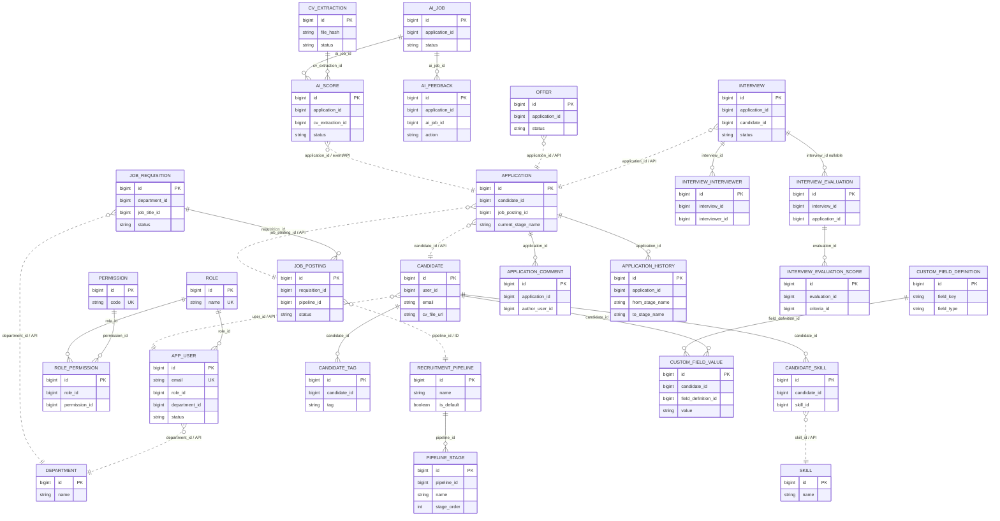

# ATS — Tầng dữ liệu

> Phạm vi: khảo sát 43 backend `@Entity`, quan hệ JPA, Flyway migration và SQLAlchemy model của `ai-service`. Đây là mô tả ở mức data model; chưa đi sâu vào repository/query/service logic. Mọi nhận định về code đều có dẫn chứng `đường/dẫn/file:line`.

## 1. Cách đọc mô hình dữ liệu

### Kết luận chính

1. Backend chia dữ liệu theo **database-per-service**. Các service có database riêng như `ats_auth`, `ats_candidate`, `ats_application`, `ats_interview`, `ats_offer` và `ats_ai` (`docker/postgres-init/init-databases.sql:1-12`, `auth-service/src/main/resources/application.yml:10-21`, `candidate-service/src/main/resources/application.yml:11-21`).
2. Quan hệ JPA trực tiếp chỉ tồn tại bên trong một service/database: ví dụ `ApplicationComment -> Application`, `CandidateTag -> Candidate`, `InterviewEvaluation -> Interview` (`application-service/src/main/java/iuh/fit/se/application/application/ApplicationComment.java:16-18`, `candidate-service/src/main/java/iuh/fit/se/candidate/candidate/CandidateTag.java:14-16`, `interview-service/src/main/java/iuh/fit/se/interview/evaluation/InterviewEvaluation.java:23-25`).
3. Liên kết giữa service chủ yếu là các field `Long` như `candidateId`, `jobPostingId`, `applicationId`, `departmentId`, `roleId`; chúng được kiểm tra qua REST/Feign hoặc event chứ không phải một JPA association xuyên database (`application-service/src/main/java/iuh/fit/se/application/application/Application.java:17-45`, `interview-service/src/main/java/iuh/fit/se/interview/interview/Interview.java:18-32`, `offer-service/src/main/java/iuh/fit/se/offer/offer/Offer.java:18-37`).
4. Vì vậy ERD dưới đây có hai loại đường: đường liền là quan hệ JPA/database nội bộ; đường nét đứt là liên kết nghiệp vụ bằng ID giữa các service, không nên hiểu là foreign key JPA xuyên database.

## 2. Tất cả Entity trong backend

Tổng cộng có 43 class được đánh dấu `@Entity`. `api-gateway` và `dashboard-service` không có `@Entity` trong source đã khảo sát; dashboard chủ yếu gọi service khác qua OpenFeign (`dashboard-service/pom.xml:28-44`, `dashboard-service/src/main/resources/application.yml:8-20`).

### 2.1. `auth-service` — identity và authentication

| Entity | Ý nghĩa nghiệp vụ và field quan trọng |
|---|---|
| `AppUser` | Tài khoản người dùng: `email` unique, `passwordHash`, `fullName`, `roleId`, `departmentId`, `status`, `emailVerified`, timestamps (`auth-service/src/main/java/iuh/fit/se/auth/entity/AppUser.java:9-45`). `roleId`/`departmentId` là ID scalar, không phải `@ManyToOne`. |
| `Company` | Profile duy nhất của doanh nghiệp: `name`, contact, `description`, `logoUrl`, `bannerUrl`, `dataRetentionMonths` (`auth-service/src/main/java/iuh/fit/se/auth/entity/Company.java:7-36`). |
| `Role` | Role hệ thống, field `name` là enum và unique/non-null (`auth-service/src/main/java/iuh/fit/se/auth/entity/Role.java:6-16`). |
| `Permission` | Permission catalog: `code` unique và `description` (`auth-service/src/main/java/iuh/fit/se/auth/entity/Permission.java:6-17`). |
| `RolePermission` | Join entity giữa role và permission, chứa `roleId`, `permissionId` (`auth-service/src/main/java/iuh/fit/se/auth/entity/RolePermission.java:6-23`). Đây là cách biểu diễn many-to-many bằng bảng trung gian, nhưng class không dùng `@ManyToMany`. |
| `EmailVerification` | OTP xác thực email: `email`, `otpHash`, `expiryDate`, `verified`, `failedAttempts` (`auth-service/src/main/java/iuh/fit/se/auth/entity/EmailVerification.java:12-33`). |
| `PasswordResetToken` | OTP reset password: `email`, `otpHash`, `expiryDate`, `used`, `failedAttempts` (`auth-service/src/main/java/iuh/fit/se/auth/entity/PasswordResetToken.java:12-33`). |
| `RefreshToken` | Refresh token đã hash: `userId`, `tokenHash` unique, `expiryDate`, `revoked` (`auth-service/src/main/java/iuh/fit/se/auth/entity/RefreshToken.java:12-31`). |

Migration còn tạo foreign key `app_user.role_id -> role.id`, nhưng object model Java vẫn giữ `roleId` dạng `Long` (`auth-service/src/main/resources/db/migration/V3__single_company_schema_baseline.sql:24-37`). Đây là ví dụ quan trọng cho việc database constraint có thể chặt hơn JPA object relationship.

### 2.2. `masterdata-service` — danh mục dùng chung

Các entity catalog sau đều có pattern chung: `id` tự tăng, `name`, `active` và timestamp; chúng được tham chiếu từ service khác bằng ID.

| Entity | Ý nghĩa và field quan trọng |
|---|---|
| `Department` | Phòng ban: `name`, `description`, `active`, `createdAt`, `updatedAt` (`masterdata-service/src/main/java/iuh/fit/se/masterdata/department/Department.java:8-33`). |
| `JobTitle` | Chức danh tuyển dụng: `name`, `active`, `createdAt` (`masterdata-service/src/main/java/iuh/fit/se/masterdata/jobtitle/JobTitle.java:7-22`). |
| `JobLevel` | Cấp bậc công việc: `name`, `orderNo`, `active` (`masterdata-service/src/main/java/iuh/fit/se/masterdata/joblevel/JobLevel.java:7-25`). |
| `EmploymentType` | Loại hình làm việc/hợp đồng: `name`, `active` (`masterdata-service/src/main/java/iuh/fit/se/masterdata/employmenttype/EmploymentType.java:7-22`). |
| `WorkLocation` | Địa điểm làm việc: `name`, `address`, `active` (`masterdata-service/src/main/java/iuh/fit/se/masterdata/worklocation/WorkLocation.java:7-24`). |
| `EducationLevel` | Trình độ học vấn: `name`, `orderNo`, `active` (`masterdata-service/src/main/java/iuh/fit/se/masterdata/educationlevel/EducationLevel.java:7-25`). |
| `ExperienceLevel` | Mức kinh nghiệm: `name`, `minYears`, `maxYears`, `active` (`masterdata-service/src/main/java/iuh/fit/se/masterdata/experiencelevel/ExperienceLevel.java:7-28`). |
| `Skill` | Kỹ năng: `name`, `category`, `active` (`masterdata-service/src/main/java/iuh/fit/se/masterdata/skill/Skill.java:7-24`). |
| `RecruitmentSource` | Nguồn ứng viên: `name`, `active` (`masterdata-service/src/main/java/iuh/fit/se/masterdata/recruitmentsource/RecruitmentSource.java:7-22`). |
| `RecruitmentStatus` | Danh mục trạng thái tuyển dụng: `name`, `orderNo`, `active` (`masterdata-service/src/main/java/iuh/fit/se/masterdata/recruitmentstatus/RecruitmentStatus.java:7-25`). |
| `RejectionReason` | Lý do từ chối: `name`, `active` (`masterdata-service/src/main/java/iuh/fit/se/masterdata/rejectionreason/RejectionReason.java:7-22`). |
| `InterviewCriteria` | Tiêu chí đánh giá interview: `name`, `description`, `active` (`masterdata-service/src/main/java/iuh/fit/se/masterdata/interviewcriteria/InterviewCriteria.java:7-24`). |
| `EmailTemplate` | Template email: `code`, `subject`, `body`, `active` (`masterdata-service/src/main/java/iuh/fit/se/masterdata/emailtemplate/EmailTemplate.java:7-28`). |
| `RecruitmentPipeline` | Một pipeline tuyển dụng: `name`, `isDefault`, `active`, danh sách `stages` (`masterdata-service/src/main/java/iuh/fit/se/masterdata/pipeline/RecruitmentPipeline.java:9-32`). |
| `PipelineStage` | Một stage trong pipeline: `pipeline`, `name`, `stageType`, `stageOrder` (`masterdata-service/src/main/java/iuh/fit/se/masterdata/pipeline/PipelineStage.java:7-27`). |

### 2.3. `recruitment-service` — nhu cầu và tin tuyển dụng

| Entity | Ý nghĩa và field quan trọng |
|---|---|
| `JobRequisition` | Nhu cầu tuyển dụng nội bộ: `title`, `departmentId`, `jobTitleId`, `quantity`, loại hình/địa điểm, salary band, `requesterId`, `approverId`, `status`, nội dung JD và `skillIds` (`recruitment-service/src/main/java/iuh/fit/se/recruitment/requisition/JobRequisition.java:12-116`). |
| `JobPosting` | Tin tuyển dụng được public: liên kết JPA tới `JobRequisition`, `title`, `employmentTypeId`, `workLocationId`, `pipelineId`, JD text, salary, `status`, thời điểm publish/close và `skillIds` (`recruitment-service/src/main/java/iuh/fit/se/recruitment/posting/JobPosting.java:14-99`). |

`skillIds` ở requisition và posting là `@ElementCollection` của các `Long`, không phải `@ManyToMany` tới `masterdata-service.Skill` (`recruitment-service/src/main/java/iuh/fit/se/recruitment/requisition/JobRequisition.java:86-90`, `recruitment-service/src/main/java/iuh/fit/se/recruitment/posting/JobPosting.java:58-62`).

### 2.4. `candidate-service` — hồ sơ ứng viên

| Entity | Ý nghĩa và field quan trọng |
|---|---|
| `Candidate` | Hồ sơ ứng viên: `userId`, thông tin cá nhân, `currentPosition`, `educationLevelId`, `cvFileUrl`, internal note, `poolStatus`, consent và collections `tags`/`skills` (`candidate-service/src/main/java/iuh/fit/se/candidate/candidate/Candidate.java:11-79`). |
| `CandidateSkill` | Bảng liên kết candidate–skill: `candidate` JPA relation và `skillId` scalar (`candidate-service/src/main/java/iuh/fit/se/candidate/candidate/CandidateSkill.java:6-19`). |
| `CandidateTag` | Tag của candidate: `candidate` và `tag` (`candidate-service/src/main/java/iuh/fit/se/candidate/candidate/CandidateTag.java:6-19`). |
| `CustomFieldDefinition` | Định nghĩa field mở rộng: `fieldKey`, `fieldLabel`, `fieldType`, `active` (`candidate-service/src/main/java/iuh/fit/se/candidate/customfield/CustomFieldDefinition.java:8-31`). |
| `CandidateCustomFieldValue` | Giá trị field mở rộng của một candidate: `candidate`, `fieldDefinition`, `value` (`candidate-service/src/main/java/iuh/fit/se/candidate/customfield/CandidateCustomFieldValue.java:7-24`). |

CV binary không nằm trong entity; `Candidate.cvFileUrl` lưu URL, còn file được upload vào S3 bởi `S3Service` (`candidate-service/src/main/java/iuh/fit/se/candidate/candidate/Candidate.java:40-48`, `candidate-service/src/main/java/iuh/fit/se/candidate/storage/S3Service.java:37-68`).

### 2.5. `application-service` — hồ sơ ứng tuyển

| Entity | Ý nghĩa và field quan trọng |
|---|---|
| `Application` | Hồ sơ ứng tuyển: `candidateId`, snapshot tên/email, `jobPostingId`, department/pipeline/source/assigned recruiter, CV URL, stage hiện tại, rejection, timestamps và bản sao AI score/tier/status (`application-service/src/main/java/iuh/fit/se/application/application/Application.java:9-94`). |
| `ApplicationComment` | Comment trao đổi trên application: application, author và content (`application-service/src/main/java/iuh/fit/se/application/application/ApplicationComment.java:8-27`). |
| `ApplicationHistory` | Lịch sử chuyển stage: application, from/to stage, note, actor và thời điểm (`application-service/src/main/java/iuh/fit/se/application/application/ApplicationHistory.java:8-33`). |

AI score trong `Application` là bản sao read/filter nhanh; nguồn AI đầy đủ nằm ở database riêng của `ai-service` (`application-service/src/main/java/iuh/fit/se/application/application/Application.java:75-85`, `application-service/src/main/resources/db/migration/V4__add_application_ai_score.sql:1-19`).

### 2.6. `interview-service` — lịch và đánh giá

| Entity | Ý nghĩa và field quan trọng |
|---|---|
| `Interview` | Một buổi phỏng vấn: application/job/candidate IDs, recruiter/department, snapshot tên candidate, lịch, format, location/link, status, confirmation/proposal và interviewers (`interview-service/src/main/java/iuh/fit/se/interview/interview/Interview.java:10-90`). |
| `InterviewInterviewer` | Người tham gia một interview: interview relation, `interviewerId`, snapshot tên (`interview-service/src/main/java/iuh/fit/se/interview/interview/InterviewInterviewer.java:6-21`). |
| `InterviewSlot` | Khung giờ đề xuất: application, candidate snapshot, start/end, format, location/link, status và các cờ confirm/matched (`interview-service/src/main/java/iuh/fit/se/interview/scheduling/InterviewSlot.java:9-64`). |
| `InterviewEvaluation` | Một phiếu đánh giá theo application, có thể gắn với interview hoặc không; chứa interviewer, recommendation, comment, salary proposal và scores (`interview-service/src/main/java/iuh/fit/se/interview/evaluation/InterviewEvaluation.java:11-55`). |
| `InterviewEvaluationScore` | Điểm cho từng criteria: evaluation, `criteriaId`, `score`, `comment` (`interview-service/src/main/java/iuh/fit/se/interview/evaluation/InterviewEvaluationScore.java:6-24`). |
| `SalaryProposal` | Đề xuất lương: application/interview IDs, salary, người đề xuất, comment, status và timestamps (`interview-service/src/main/java/iuh/fit/se/interview/scheduling/SalaryProposal.java:9-48`). |

Migration V8 cho phép evaluation thuộc về application mà không bắt buộc có interview; vì vậy `InterviewEvaluation.interview` nullable là chủ ý nghiệp vụ (`interview-service/src/main/resources/db/migration/V8__evaluation_per_application.sql:1-24`, `interview-service/src/main/java/iuh/fit/se/interview/evaluation/InterviewEvaluation.java:23-29`).

### 2.7. `notification-service` — notification và audit

| Entity | Ý nghĩa và field quan trọng |
|---|---|
| `Notification` | Thông báo cho user: `recipientUserId`, type, title/message, resource reference, `read`, created time (`notification-service/src/main/java/iuh/fit/se/notification/notification/Notification.java:8-39`). |
| `AuditLog` | Audit event: actor, action, resource type/id, metadata và timestamp (`notification-service/src/main/java/iuh/fit/se/notification/auditlog/AuditLog.java:8-37`). |

`recipientUserId`, `actorUserId` và `resourceId` đều là scalar reference; notification service không có JPA association tới `AppUser` hay domain entity ở service khác (`notification-service/src/main/java/iuh/fit/se/notification/notification/Notification.java:16-33`, `notification-service/src/main/java/iuh/fit/se/notification/auditlog/AuditLog.java:21-34`).

### 2.8. `offer-service` — offer

| Entity | Ý nghĩa và field quan trọng |
|---|---|
| `Offer` | Đề nghị nhận việc: application/job/department/recruiter/candidate IDs, snapshot candidate/job, salary/contract/start date, probation, location, currency/pay frequency/benefits, deadline, requester/approver, status, reject/decline và timestamps (`offer-service/src/main/java/iuh/fit/se/offer/offer/Offer.java:10-136`). |

Offer giữ nhiều snapshot như `candidateNameSnapshot`, `candidateEmailSnapshot`, `jobTitleSnapshot` để nội dung offer không bị thay đổi ngược khi dữ liệu gốc đổi (`offer-service/src/main/java/iuh/fit/se/offer/offer/Offer.java:36-50`, `offer-service/src/main/resources/db/migration/V6__phase6_offer_terms_and_artifact.sql:8-14`, `offer-service/src/main/resources/db/migration/V6__phase6_offer_terms_and_artifact.sql:41-55`).

## 3. Quan hệ giữa các Entity

### 3.1. Quan hệ JPA trực tiếp

| Quan hệ | Kiểu | Cách mapping | Ý nghĩa |
|---|---|---|---|
| `RecruitmentPipeline -> PipelineStage` | 1–N | `PipelineStage.pipeline` là `@ManyToOne LAZY`; `RecruitmentPipeline.stages` là `@OneToMany(mappedBy="pipeline")` | Một pipeline có nhiều stage; xóa pipeline có thể cascade xuống stage và orphan stage (`masterdata-service/src/main/java/iuh/fit/se/masterdata/pipeline/PipelineStage.java:15-27`, `masterdata-service/src/main/java/iuh/fit/se/masterdata/pipeline/RecruitmentPipeline.java:29-32`). |
| `JobRequisition -> JobPosting` | 1–N | `JobPosting.requisition` là `@ManyToOne LAZY` | Một requisition có thể sinh nhiều posting; phía requisition không có collection ngược trong entity hiện tại (`recruitment-service/src/main/java/iuh/fit/se/recruitment/posting/JobPosting.java:22-24`). |
| `Candidate -> CandidateTag` | 1–N | `Candidate.tags` `@OneToMany(mappedBy="candidate", cascade=ALL, orphanRemoval=true)`; child `@ManyToOne LAZY` | Tag là dữ liệu con sống cùng candidate (`candidate-service/src/main/java/iuh/fit/se/candidate/candidate/Candidate.java:64-67`, `candidate-service/src/main/java/iuh/fit/se/candidate/candidate/CandidateTag.java:14-16`). |
| `Candidate -> CandidateSkill` | 1–N | Giống tag; `skillId` là scalar | Một candidate có nhiều dòng skill, nhưng Skill catalog ở service khác (`candidate-service/src/main/java/iuh/fit/se/candidate/candidate/Candidate.java:77-79`, `candidate-service/src/main/java/iuh/fit/se/candidate/candidate/CandidateSkill.java:14-19`). |
| `Candidate -> CandidateCustomFieldValue` | 1–N về nghiệp vụ | Value giữ `candidate` bằng `@ManyToOne LAZY` | Một candidate có nhiều giá trị custom field; entity `Candidate` hiện không khai báo collection ngược (`candidate-service/src/main/java/iuh/fit/se/candidate/customfield/CandidateCustomFieldValue.java:15-24`). |
| `CustomFieldDefinition -> CandidateCustomFieldValue` | 1–N về nghiệp vụ | Value giữ `fieldDefinition` bằng `@ManyToOne LAZY` | Một định nghĩa field được dùng cho nhiều candidate value (`candidate-service/src/main/java/iuh/fit/se/candidate/customfield/CandidateCustomFieldValue.java:19-21`). |
| `Application -> ApplicationComment` | 1–N | Comment giữ `@ManyToOne LAZY` tới application | Comment bị gắn với một hồ sơ ứng tuyển (`application-service/src/main/java/iuh/fit/se/application/application/ApplicationComment.java:16-18`). |
| `Application -> ApplicationHistory` | 1–N | History giữ `@ManyToOne LAZY` tới application | Một application có nhiều lần chuyển stage (`application-service/src/main/java/iuh/fit/se/application/application/ApplicationHistory.java:16-18`). |
| `Interview -> InterviewInterviewer` | 1–N | `Interview.interviewers` cascade ALL/orphan removal; child giữ `@ManyToOne LAZY` | Một buổi phỏng vấn có nhiều interviewer (`interview-service/src/main/java/iuh/fit/se/interview/interview/Interview.java:88-90`, `interview-service/src/main/java/iuh/fit/se/interview/interview/InterviewInterviewer.java:14-16`). |
| `Interview -> InterviewEvaluation` | 1–N | `Interview.evaluations` không có collection trong entity hiện tại; evaluation giữ `interview` nullable | Có thể đánh giá theo interview hoặc theo application không có interview (`interview-service/src/main/java/iuh/fit/se/interview/evaluation/InterviewEvaluation.java:23-29`, `interview-service/src/main/resources/db/migration/V8__evaluation_per_application.sql:15-21`). |
| `InterviewEvaluation -> InterviewEvaluationScore` | 1–N | Evaluation có `@OneToMany(cascade=ALL, orphanRemoval=true)`; score giữ `@ManyToOne LAZY` | Một evaluation có nhiều điểm theo criteria (`interview-service/src/main/java/iuh/fit/se/interview/evaluation/InterviewEvaluation.java:53-55`, `interview-service/src/main/java/iuh/fit/se/interview/evaluation/InterviewEvaluationScore.java:14-16`). |
| `JobRequisition -> skillIds` và `JobPosting -> skillIds` | 1–N value collection | `@ElementCollection` + `@CollectionTable` | Các bảng phụ chỉ lưu ID skill; không phải entity `Skill` và không có JPA FK xuyên service (`recruitment-service/src/main/java/iuh/fit/se/recruitment/requisition/JobRequisition.java:86-90`, `recruitment-service/src/main/java/iuh/fit/se/recruitment/posting/JobPosting.java:58-62`). |

### 3.2. Quan hệ nghiệp vụ giữa service

Các quan hệ dưới đây tồn tại ở mức ID/API/event, không phải JPA association:

| Bên nguồn | Field/reference | Bên đích | Bằng chứng |
|---|---|---|---|
| `AppUser` | `roleId`, `departmentId` | `Role`, `Department` | `auth-service/src/main/java/iuh/fit/se/auth/entity/AppUser.java:28-32`; foreign key role được thêm bởi migration (`auth-service/src/main/resources/db/migration/V3__single_company_schema_baseline.sql:33-37`). |
| `Candidate` | `userId`, `educationLevelId` | Auth user, masterdata education | `candidate-service/src/main/java/iuh/fit/se/candidate/candidate/Candidate.java:19-41`. |
| `CandidateSkill` | `skillId` | `masterdata.Skill` | `candidate-service/src/main/java/iuh/fit/se/candidate/candidate/CandidateSkill.java:14-19`. |
| `JobRequisition` | department/job title/level/employment/location/pipeline IDs | Masterdata | `recruitment-service/src/main/java/iuh/fit/se/recruitment/requisition/JobRequisition.java:23-43`. |
| `JobPosting` | requisition JPA relation; masterdata/pipeline IDs | Recruitment nội bộ + masterdata | `recruitment-service/src/main/java/iuh/fit/se/recruitment/posting/JobPosting.java:22-43`. |
| `Application` | `candidateId`, `jobPostingId`, `pipelineId`, `currentStageId` | Candidate, recruitment, masterdata | `application-service/src/main/java/iuh/fit/se/application/application/Application.java:17-55`. |
| `Interview` | `applicationId`, `jobPostingId`, `candidateId`, `workLocationId` | Application, recruitment, candidate, masterdata | `interview-service/src/main/java/iuh/fit/se/interview/interview/Interview.java:18-50`. |
| `Offer` | `applicationId`, `jobPostingId`, `candidateId`, `contractTypeId`, `workLocationId` | Application, recruitment, candidate, masterdata | `offer-service/src/main/java/iuh/fit/se/offer/offer/Offer.java:18-70`. |
| `Notification` | `recipientUserId`, `resourceId` | User/domain resource | `notification-service/src/main/java/iuh/fit/se/notification/notification/Notification.java:16-33`. |

Lý do thiết kế như vậy là mỗi service sở hữu database riêng; Java service dùng OpenFeign để lấy dữ liệu từ service khác, ví dụ application gọi recruitment/candidate qua HTTP (`application-service/src/main/java/iuh/fit/se/application/client/RecruitmentServiceClient.java:4-13`, `application-service/src/main/java/iuh/fit/se/application/client/CandidateServiceClient.java:5-16`).

## 4. ERD bằng Mermaid

Sơ đồ mô tả cả quan hệ nội bộ và các liên kết ID liên-service. Đường nét đứt có nhãn `ID/API` không phải JPA foreign key trực tiếp.



Một số catalog entity như `Skill`, `Department`, `JobTitle`, `ContractType` không được lặp toàn bộ trong phần lõi ERD vì chúng là bảng danh mục độc lập; chúng vẫn được liệt kê đầy đủ ở mục 2.2. `skillIds`/`criteriaId`/`workLocationId` là ID scalar trong source, nên sơ đồ không được diễn giải thành JPA relation (`recruitment-service/src/main/java/iuh/fit/se/recruitment/posting/JobPosting.java:58-62`, `interview-service/src/main/java/iuh/fit/se/interview/evaluation/InterviewEvaluationScore.java:18-22`).

## 5. Các annotation JPA quan trọng

### `@Entity`

Đánh dấu class là persistent entity được Hibernate quản lý và ánh xạ vào table. Ví dụ `Application`, `Candidate` và `Offer` đều dùng `@Entity` (`application-service/src/main/java/iuh/fit/se/application/application/Application.java:9-12`, `candidate-service/src/main/java/iuh/fit/se/candidate/candidate/Candidate.java:11-14`, `offer-service/src/main/java/iuh/fit/se/offer/offer/Offer.java:10-13`).

### `@Id` và `@GeneratedValue`

`@Id` xác định primary key của entity. `@GeneratedValue(strategy = GenerationType.IDENTITY)` để database tự sinh ID khi insert, phù hợp với các cột `BIGINT ... AS IDENTITY` trong migration (`candidate-service/src/main/java/iuh/fit/se/candidate/candidate/Candidate.java:14-17`, `docker/postgres-init/init-databases.sql:100-106`).

Nếu không có ID, Hibernate không thể định danh entity để theo dõi thay đổi, update hoặc delete. Hầu hết entity trong repo dùng ID tự tăng; ví dụ cả `ApplicationComment` và `InterviewEvaluationScore` đều có pattern này (`application-service/src/main/java/iuh/fit/se/application/application/ApplicationComment.java:11-14`, `interview-service/src/main/java/iuh/fit/se/interview/evaluation/InterviewEvaluationScore.java:9-12`).

### `@ManyToOne`, `@OneToMany` và `@JoinColumn`

- `@ManyToOne` đặt ở phía nhiều, chứa foreign key. `JobPosting.requisition` dùng `@JoinColumn(name="requisition_id", nullable=false)` (`recruitment-service/src/main/java/iuh/fit/se/recruitment/posting/JobPosting.java:22-24`).
- `@OneToMany(mappedBy="...")` đặt ở phía một để nói rằng foreign key thuộc entity con, không tạo thêm cột ở bảng cha. `Candidate.tags` và `Candidate.skills` dùng cách này (`candidate-service/src/main/java/iuh/fit/se/candidate/candidate/Candidate.java:64-79`).
- `@JoinColumn` quyết định tên cột FK và constraint nullability. `nullable=false` ngăn một child tồn tại mà không có parent (`candidate-service/src/main/java/iuh/fit/se/candidate/customfield/CandidateCustomFieldValue.java:15-21`).

Các annotation này quan trọng vì chúng quyết định object graph, FK column, cách Hibernate join dữ liệu và thứ tự persist/delete.

### `cascade = CascadeType.ALL`

Cascade truyền thao tác persist/update/delete từ parent sang child. Ví dụ khi xử lý `Candidate`, các `CandidateTag`/`CandidateSkill` có thể được lưu hoặc xóa cùng parent (`candidate-service/src/main/java/iuh/fit/se/candidate/candidate/Candidate.java:64-79`). Pipeline stage, interview interviewer và evaluation score cũng dùng cascade (`masterdata-service/src/main/java/iuh/fit/se/masterdata/pipeline/RecruitmentPipeline.java:29-32`, `interview-service/src/main/java/iuh/fit/se/interview/interview/Interview.java:88-90`, `interview-service/src/main/java/iuh/fit/se/interview/evaluation/InterviewEvaluation.java:53-55`).

### `orphanRemoval = true`

Khi child bị bỏ khỏi collection của parent, Hibernate có thể xóa row child thay vì để lại dữ liệu mồ côi. Điều này phù hợp với tag, skill link, pipeline stage, interviewer link và evaluation score vì chúng không có ý nghĩa độc lập ngoài parent (`candidate-service/src/main/java/iuh/fit/se/candidate/candidate/Candidate.java:64-79`, `masterdata-service/src/main/java/iuh/fit/se/masterdata/pipeline/RecruitmentPipeline.java:29-32`).

### `fetch = FetchType.LAZY` và `EAGER`

`LAZY` nghĩa là association chưa được tải ngay khi load parent; Hibernate chỉ query child khi code thực sự truy cập association. Repo chủ động dùng `fetch = FetchType.LAZY` cho các `@ManyToOne` như `JobPosting.requisition`, `CandidateTag.candidate`, `InterviewInterviewer.interview` và `CandidateCustomFieldValue.fieldDefinition` (`recruitment-service/src/main/java/iuh/fit/se/recruitment/posting/JobPosting.java:22-24`, `candidate-service/src/main/java/iuh/fit/se/candidate/candidate/CandidateTag.java:14-16`, `interview-service/src/main/java/iuh/fit/se/interview/interview/InterviewInterviewer.java:14-16`, `candidate-service/src/main/java/iuh/fit/se/candidate/customfield/CandidateCustomFieldValue.java:19-21`).

`EAGER` sẽ tải association ngay cùng parent và có thể tạo nhiều join/query không cần thiết. Trong các entity đã khảo sát chưa thấy `fetch = FetchType.EAGER` explicit; các collection `@OneToMany` cũng không khai báo EAGER (`candidate-service/src/main/java/iuh/fit/se/candidate/candidate/Candidate.java:64-79`, `interview-service/src/main/java/iuh/fit/se/interview/evaluation/InterviewEvaluation.java:53-55`). Vì vậy chưa có bằng chứng rằng repo cố ý dùng EAGER cho các quan hệ này.

### `@Column` và constraint

`@Column` điều chỉnh mapping field–column và ràng buộc dữ liệu:

- `nullable = false`: field bắt buộc, ví dụ email user, title posting, salary offer (`auth-service/src/main/java/iuh/fit/se/auth/entity/AppUser.java:17-24`, `recruitment-service/src/main/java/iuh/fit/se/recruitment/posting/JobPosting.java:26-43`, `offer-service/src/main/java/iuh/fit/se/offer/offer/Offer.java:52-59`).
- `unique = true`: không cho trùng, ví dụ email user, role name, refresh token hash (`auth-service/src/main/java/iuh/fit/se/auth/entity/AppUser.java:17-18`, `auth-service/src/main/java/iuh/fit/se/auth/entity/Role.java:14-16`, `auth-service/src/main/java/iuh/fit/se/auth/entity/RefreshToken.java:24-25`).
- `name = "..."`: ánh xạ tên Java camelCase sang tên SQL, ví dụ `passwordHash -> password_hash` (`auth-service/src/main/java/iuh/fit/se/auth/entity/AppUser.java:20-24`).
- `length`: giới hạn độ dài varchar, ví dụ `proposalNote` dài tối đa 500 (`interview-service/src/main/java/iuh/fit/se/interview/interview/Interview.java:75-80`).
- `precision`/`scale`: kiểm soát số tiền, ví dụ salary proposal precision 15 scale 2 (`interview-service/src/main/java/iuh/fit/se/interview/scheduling/SalaryProposal.java:28-31`).
- `columnDefinition = "TEXT"` hoặc `JSONB`: dùng cho nội dung dài/JSON, ví dụ description, requirements và benchmark criteria (`recruitment-service/src/main/java/iuh/fit/se/recruitment/posting/JobPosting.java:45-56`).

Ngoài `@Column`, code dùng `@Enumerated(EnumType.STRING)` cho status/type. Lưu enum bằng tên string dễ đọc và tránh phụ thuộc vào thứ tự enum (`auth-service/src/main/java/iuh/fit/se/auth/entity/AppUser.java:34-36`, `offer-service/src/main/java/iuh/fit/se/offer/offer/Offer.java:109-111`).

### `@ElementCollection` và `@CollectionTable`

Đây là collection value type không có lifecycle/entity identity riêng. Repo dùng nó để lưu danh sách `skillId` ở bảng phụ `job_requisition_skill` và `job_posting_skill` (`recruitment-service/src/main/java/iuh/fit/se/recruitment/requisition/JobRequisition.java:86-90`, `recruitment-service/src/main/java/iuh/fit/se/recruitment/posting/JobPosting.java:58-62`). Cách này đơn giản hơn `@ManyToMany`, nhưng Hibernate không tự hiểu đó là object `Skill` thuộc service khác.

## 6. Flyway migration

### Công cụ đang dùng

Backend dùng Flyway, không thấy Liquibase dependency hoặc thư mục Liquibase migration trong các module đã khảo sát. Ví dụ `auth-service` khai báo `flyway-core` và `flyway-database-postgresql` (`auth-service/pom.xml:25-38`), đồng thời bật Flyway và baseline trong runtime config (`auth-service/src/main/resources/application.yml:14-21`). Các service JPA khác cũng có pattern Flyway tương tự (`candidate-service/pom.xml:38-71`, `application-service/pom.xml:37-71`).

### Phạm vi migration theo service

| Service | Dải migration hiện có | Chủ đề chính |
|---|---|---|
| `auth-service` | `V1`–`V4` | single-company schema, email verification, auth token security; ví dụ `V3` thêm department/index/FK role (`auth-service/src/main/resources/db/migration/V3__single_company_schema_baseline.sql:1-43`). |
| `masterdata-service` | `V1`–`V2` | schema master data và loại bỏ legacy tenant columns. |
| `recruitment-service` | `V1`–`V4` | requisition/posting, headcount reservation, benchmark criteria. |
| `candidate-service` | `V1`–`V3` | candidate schema và bỏ legacy tenant columns. |
| `application-service` | `V1`–`V5` | application schema, department scope và AI score mirror; `V4` thêm `ai_score`, `ai_tier`, `ai_status`, `ai_updated_at` (`application-service/src/main/resources/db/migration/V4__add_application_ai_score.sql:1-19`). |
| `interview-service` | `V1`–`V8` | interview scheduling, session/scorecard và evaluation theo application; `V8` cho phép `interview_id` nullable (`interview-service/src/main/resources/db/migration/V8__evaluation_per_application.sql:1-24`). |
| `notification-service` | `V1`–`V4` | notification, audit log, inbox/processed event và lifecycle (`notification-service/src/main/resources/db/migration/V3__phase0_schema_and_inbox.sql:1-33`). |
| `offer-service` | `V1`–`V7` | offer lifecycle, terms, revisions, artifact và response expiry; `V6` tạo revision/artifact với FK nội bộ và constraint nghiệp vụ (`offer-service/src/main/resources/db/migration/V6__phase6_offer_terms_and_artifact.sql:145-216`). |

Danh sách filename đầy đủ nằm trong các thư mục `src/main/resources/db/migration/` của từng service. `api-gateway` không có persistence entity/migration; `dashboard-service` cũng không có JPA/PostgreSQL dependency trong POM (`dashboard-service/pom.xml:28-44`, `dashboard-service/src/main/resources/application.yml:1-20`).

### Migration và Hibernate cùng tồn tại

Các service bật `spring.jpa.hibernate.ddl-auto: update` đồng thời bật Flyway; ví dụ candidate config thể hiện cả hai (`candidate-service/src/main/resources/application.yml:15-22`). Vì vậy:

- Flyway quản lý các thay đổi schema có version.
- Hibernate có thể tự cập nhật một phần schema từ entity.
- Migration có comment/guard để xử lý database cũ và thứ tự chạy trước Hibernate (`application-service/src/main/resources/db/migration/V4__add_application_ai_score.sql:1-5`).

Đây là điểm cần cẩn thận khi học data layer: không nên chỉ đọc entity để kết luận toàn bộ schema; migration có thể tạo thêm index, constraint, bảng outbox/inbox, snapshot hoặc artifact mà entity hiện tại không thể hiện hết.

Ví dụ `notification-service` migration tạo thêm `processed_event` cho idempotency (`notification-service/src/main/resources/db/migration/V3__phase0_schema_and_inbox.sql:23-33`), còn `offer-service` migration tạo `offer_term_revision` và `offer_artifact` (`offer-service/src/main/resources/db/migration/V6__phase6_offer_terms_and_artifact.sql:145-204`).

## 7. Dữ liệu riêng của AI Python

### AI có database riêng không?

Có. Compose tạo database `ats_ai`, AI dùng SQLAlchemy async với URL mặc định `postgresql+asyncpg://.../ats_ai` (`docker/postgres-init/init-databases.sql:92-99`, `ai-service/app/core/config.py:20-24`). Engine dùng connection pool async và session factory (`ai-service/app/core/database.py:5-23`).

AI không dùng trực tiếp các JPA entity của Java. Các field `application_id`, `candidate_id`, `job_posting_id` là ID scalar để gọi Java service hoặc liên kết nghiệp vụ (`ai-service/app/models/__init__.py:16-24`, `ai-service/app/models/__init__.py:139-153`).

### Các SQLAlchemy model

| Model/table | Ý nghĩa và field quan trọng |
|---|---|
| `AIJob` / `ai_jobs` | Một lần xử lý AI: application/candidate/posting IDs, `status`, `current_stage`, model/prompt provenance, confidence, OCR/injection flags, token/cost/latency, error/retry (`ai-service/app/models/__init__.py:16-53`). |
| `CVDocumentChunk` / `cv_document_chunks` | Các đoạn CV dùng cho RAG: application/candidate IDs, `chunk_type`, `content`, `embedding Vector(1024)` (`ai-service/app/models/__init__.py:56-68`). |
| `AIFeedback` / `ai_feedback` | Feedback của recruiter: application ID, `ai_job_id`, user ID, action, original/corrected score và comment (`ai-service/app/models/__init__.py:71-85`). |
| `CVExtraction` / `cv_extractions` | Kết quả đọc CV: hash file + prompt version, resume URL, candidate ID, status, model, JSON result/provenance/metadata, lỗi; unique theo `(file_hash, prompt_version)` (`ai-service/app/models/__init__.py:88-113`). |
| `JDExtraction` / `jd_extractions` | Kết quả tách JD: content hash + prompt version, posting ID, status, model, JSON result/provenance, lỗi; unique theo `(content_hash, prompt_version)` (`ai-service/app/models/__init__.py:116-136`). |
| `AIScore` / `ai_scores` | Điểm cuối của application: `application_id` unique, posting/candidate IDs, liên kết tới CV extraction và AI job, status, total score, tier, JSON result/provenance và timestamps (`ai-service/app/models/__init__.py:139-162`). |

Database init cũng tạo các bảng AI và vector index HNSW cho CV chunks (`docker/postgres-init/init-databases.sql:100-150`, `docker/postgres-init/init-databases.sql:167-224`). Khi app khởi động, `main.py` gọi `Base.metadata.create_all` cho bốn bảng chính nếu chúng chưa có (`ai-service/app/main.py:35-45`).

### Alembic có được dùng không?

Repo có `ai-service/alembic/env.py` và `script.py.mako`, nhưng thư mục đã khảo sát không có version migration cụ thể; `env.py` chỉ cấu hình `target_metadata` và runner offline/online (`ai-service/alembic/env.py:12-20`, `ai-service/alembic/env.py:22-61`). Runtime hiện rõ ràng dùng `create_all` lúc startup (`ai-service/app/main.py:39-45`). Vì vậy kết luận an toàn là: **backend Java dùng Flyway; AI hiện dựa vào schema init/create_all, chưa có bằng chứng về một chuỗi Alembic version migration đang được sử dụng**.

## 8. Tóm tắt để ghi nhớ

```text
Auth DB       : user, role, permission, token, company
Masterdata DB : catalog và recruitment pipeline
Recruitment DB: requisition, posting
Candidate DB  : profile, skill/tag, custom field
Application DB: application, comment, history, AI score mirror
Interview DB  : interview, slot, interviewer, evaluation, salary proposal
Notification DB: notification, audit
Offer DB      : offer và các bảng mở rộng do migration tạo
AI DB         : jobs, extraction, chunks/vector, scores, feedback
```

Điểm cốt lõi: **JPA relation biểu diễn quan hệ nội bộ một database; `Long` ID + REST/Feign/RabbitMQ biểu diễn quan hệ giữa các service**. Đây là lý do ERD toàn hệ thống có nhiều đường nét đứt thay vì một mạng foreign key duy nhất.

Bạn đã phân biệt được `@ManyToOne` thật trong cùng database với `candidateId` chỉ là liên kết nghiệp vụ giữa hai service chưa?
